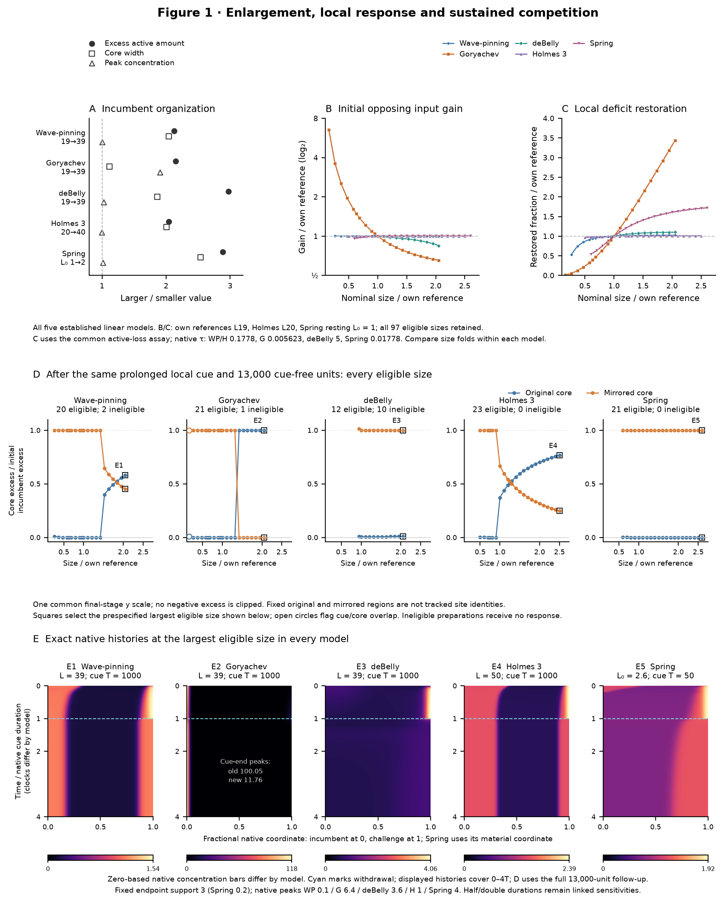
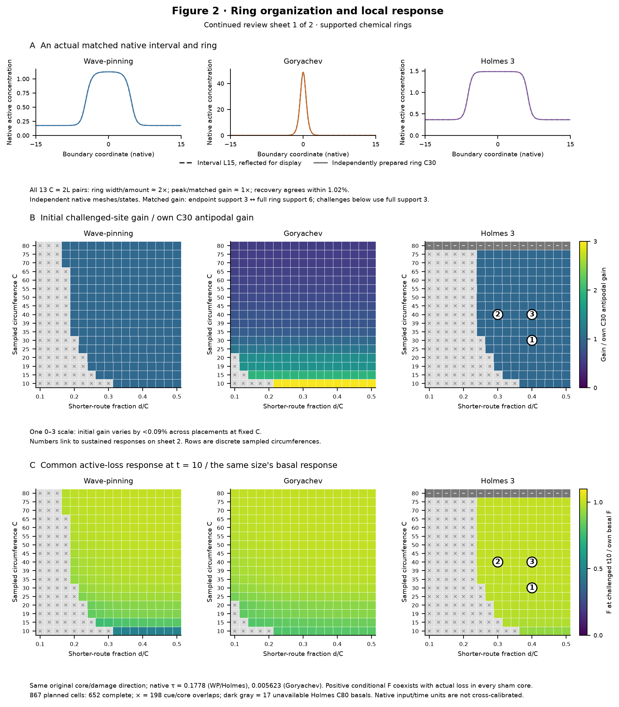
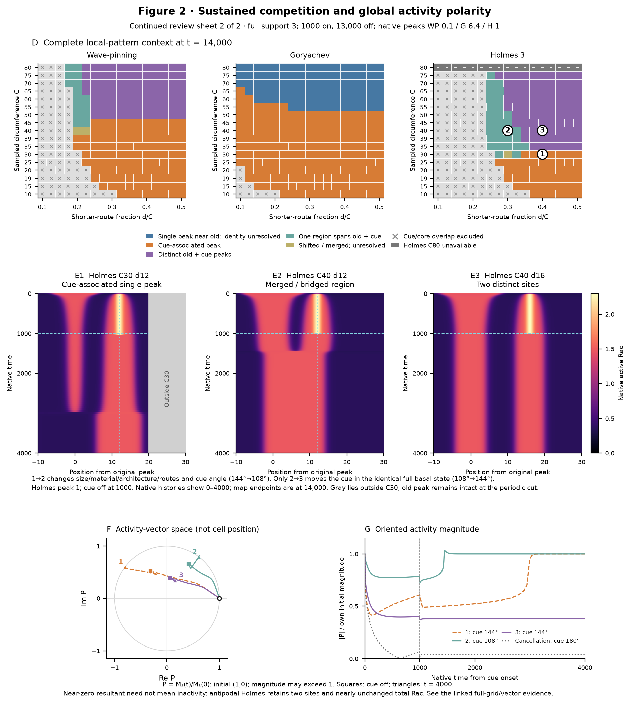
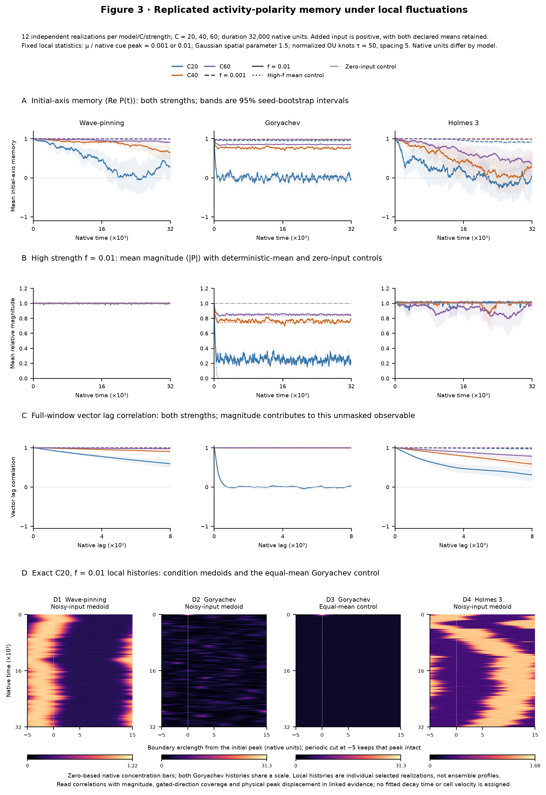

# Vision aligned mechanism and measurement checkpoint

**Initial review checkpoint, 17 October 2026.** These are three supplied figure candidates for the mechanism and measurement component of the manuscript vision. They are not an author-approved final composition or a completed manuscript. Working Figure 2 uses two continued review sheets. The proposed manuscript outline assigns these candidates Figures 2–4; those numbers do not change the scientific content or source artwork.

The [author’s manuscript vision](../MANUSCRIPT_VISION.md) connects enlargement-dependent polarity organization and replacement to a migration-persistence hypothesis. Existing migration observations and conditional OU velocity-memory estimates remain separate evidence. **The new SUM-159 chemically induced WGD+/− motility results retain a prominent reserved major results section and main figure.** Mechanism-linked cellular measurements below are proposed follow-up, not reported laboratory outcomes.

All requested model experiments are now measured: 97 all-five linear gain/recovery states and 97 primary finite branches with 30 duration anchors; supported ring recovery on 50 basals and 652 exact challenged states within 867 planned geometry cells; and 216 independent noisy realizations plus 27 controls. No native simulation was restarted to repair the later statistics validation.

## Working Figure 1: Incumbent enlargement changes local response and sustained competition in five linear models

**Message.** All five models acquire more incumbent material, while its organization and functional consequences differ. Near-doubling gain folds are 0.65361 for Goryachev and 0.84570 for corrected deBelly; the other three are approximately one. The corresponding common-recovery folds are 1.02562 for Wave-pinning, 3.43942 for Goryachev, 1.10175 for deBelly, 1.00871 for Holmes and 1.60800 for Spring. These are within-model size effects along a declared active-loss disturbance, rather than cross-model stability rankings. Finite stimulation separates activation from later survival. At the longest intervals Wave-pinning and Holmes retain two threshold-defined regions, whereas Goryachev restores the original incumbent after transient challenger activity. All retained deBelly and Spring primary branches end right-oriented. deBelly exposes why cue-on amplitude and orientation alone are insufficient: L18 mirrored-core excess falls from about 7.99 initial-incumbent units during the cue to about 1.013 afterward. At 3000 cue-free units, 12/12 branches pass orientation, 5/12 scalar strength and 0/12 the field-tail flag, compared with 12/11/12 at 8000–13,000.

**Why this composition.** The all-five organization comparison anchors the mechanism question. Complete gain and recovery curves retain weak, near-null and strong size effects on shared scales. Fixed-exposure outcomes receive their own full row, then prespecified longest-size native histories make those regional summaries tangible. No ring values or selected two-model exemplars replace the linear evidence.

**Detailed legend.**

A, Larger/smaller ratios of incumbent excess-active amount, half-contrast core width and absolute peak concentration. Pairs are L19→39, Holmes L20→40 and Spring resting L₀1→2. Amount is the above-background integral in the incumbent core; it is not an exact width × peak product. Goryachev mainly raises concentration, while the other models predominantly broaden the incumbent. deBelly uses corrected independent endpoints; Spring uses its actual physical domain.

B, Cue-weighted incremental primary-activity production per unit native opposing input, shown for all 97 qualifying basal checkpoints. Native gain is inactive substrate for Wave-pinning/Goryachev/Spring, inactive Rac divided by 7.5 for Holmes and 0.04/(1+Rho²) for deBelly, which has no explicit inactive Rac pool. Gain and nominal size are divided by each model's reference: L19, Holmes L20 or Spring L₀1. The shared logarithmic gain axis preserves nearly unchanged responses.

C, Sham-relative deficit restoration after the same small active-deactivation perturbation at every qualified size. Remove 0.5% of a smooth compact taper of the frozen basal incumbent excess profile; 0.1%/1% amplitudes check linearity. Transfer removed material pointwise to the explicit inactive pool where present; deBelly changes Rac alone, initially preserving MCA/mechanical/controller states. All native fields then evolve without an opposing cue. Integrate the deficit between sham and probe in the fixed original core and measure its repaired fraction at one fixed clock per model. Plot that fraction relative to the same reference as B. Native clocks are 0.1778279410 for Wave-pinning/Holmes, 0.00562341325 for Goryachev, 5 for deBelly and 0.01778279410 for Spring. These clocks do not calibrate biochemical rates across models.

D, Every qualifying size after a fixed opposing cue and 13,000 cue-free units. Endpoint raised-cosine support is 3 (Spring 0.2), peaks are 0.1/6.4/3.6/1/4 for Wave-pinning/Goryachev/deBelly/Holmes/Spring, and duration is 1000 native units (Spring 50), unchanged across sizes. These retain the [established sampled long-assay exposures](../polarity1d/manuscript/figures/length_mechanisms_20261008/dev/vision_linear_20261017/supporting/metadata/LONG_CUE_INVENTORY.md), including Spring's native 50-unit search cap (reference strength clock approximately 0.310); durations are not retuned to obtain success at each size. Original and mirrored core excess amounts use the frozen basal background and divide by initial incumbent excess. One final-stage y scale retains signed values; negative excess means activity below basal background, not negative concentration. Open circles flag cue/core overlap. Coverage is 97 qualified states and 13 preparation-ineligible sizes; no response is invented for an ineligible start.

E1–E5, Exact native histories at the prespecified largest qualifying size of each model: L39/L39/L39/L50/Spring L₀2.6. Squares in D identify these choices. Horizontal coordinate is fractional native position, with Spring in material coordinates; time is divided by each native cue duration. Cyan marks withdrawal. The displayed history covers 0–4 cue durations, whereas D uses the complete 13,000-unit follow-up. Zero-based activity color scales are model-specific. Fixed-support sequences do not replace the previously specified relative-20% deBelly illustrations.

All 97 original full-span recovery archives qualify at their fixed clocks, with numerical sensitivity, amplitude-linearity and unsaturated-prefix checks. The separate Spring early-window amendment is additional validation and is unused by the main collection. The finite campaign contains 97 primary branches plus 30 prespecified half/double-duration anchors. The new histories reproduce all original 10,000-unit orientation, scalar-strength and field-tail flags; those are distinct finite-window diagnostics.

$$
D(t)=A_{\mathrm{sham},\Omega_0}(t)-A_{\mathrm{probe},\Omega_0}(t)
\tag{1}
$$

The amount is integrated over the frozen original incumbent core; Spring uses each trajectory's physical length with fixed material-coordinate membership.

$$
F_\tau=\frac{D(0)-D(\tau)}{D(0)},\qquad K_\tau=\frac{F_\tau}{\tau}
\tag{2}
$$

The figure shows restored fraction relative to its model-specific reference. A positive fraction means that one regional perturbation-induced deficit shrank relative to sham.

**Corresponding experimental measurements.**

- Measure incumbent physical extent, peak and excess integrated reporter signal against measured cell size. Molecular-amount interpretation requires calibration; spatial broadening and increased concentration-like signal should remain separate.
- Apply a characterized local input and measure early challenger activation separately from its later establishment. Use a specified incumbent-targeted activity reduction and paired sham to measure actual local loss/rebound and shrinking sham-relative deficit over a declared window.
- Track both sites during substantial fixed stimulation and after withdrawal, retaining extinction, return, merger, replacement and coexistence histories. Record local protrusion independently to test activity–protrusion correspondence; these experiments are proposed.

**Interpretation limits.**

- A positive regional recovery coefficient does not establish generic stability or resistance to an actual challenger; deBelly's Rac-only kick leaves slower organization initially intact. Fixed cores do not uniquely track site identity.
- Native clocks, length scales and input channels are not biological dose/time calibrations. Goryachev L39's core contains only four native cell centers; solver checks do not establish spatial convergence.
- Half/double-duration controls establish bounded sensitivity, not a universal commitment threshold. Field-tail flags and finite retained patterns do not prove attractors or a cell-velocity law.

**Supporting evidence.**

- [All-five actual results and measurements](../polarity1d/manuscript/figures/length_mechanisms_20261008/dev/vision_linear_20261017/RESULTS.md)
- [Complete normalized linear gain](../polarity1d/manuscript/figures/length_mechanisms_20261008/dev/vision_aligned_checkpoint_20261017/supporting/data/vision_aligned_linear_gain.csv)
- [Complete qualified linear recovery](../polarity1d/manuscript/figures/length_mechanisms_20261008/dev/vision_aligned_checkpoint_20261017/supporting/data/vision_aligned_linear_recovery.csv)
- [Finite competition and duration checks](../polarity1d/manuscript/figures/length_mechanisms_20261008/dev/vision_linear_20261017/supporting/metadata/FINITE_RESULTS.md)
- [Compact exact native display histories](../polarity1d/manuscript/figures/length_mechanisms_20261008/dev/vision_aligned_checkpoint_20261017/supporting/data/vision_aligned_linear_native_display.npz)
- [Assembly provenance](../polarity1d/manuscript/figures/length_mechanisms_20261008/dev/vision_aligned_checkpoint_20261017/supporting/metadata/vision_aligned_checkpoint.manifest.json)

## Working Figure 2: Challenger placement changes sustained competition and global activity polarity on supported rings

**Message.** Initial local gain varies by less than 0.09% across qualified placements at fixed circumference, while sustained competition produces sharply different local patterns. Input gain alone therefore does not determine later site fate. Every challenged conditional repaired fraction is positive even though the actual unperturbed original core loses active material during the same window. Challenged/basal ratios span 0.469–1.000 in Wave-pinning, 0.798–1.000 in Goryachev and 0.921–0.999 in Holmes. The complete finite maps contain 81 Wave-pinning and 82 Holmes distinct-old-plus-cue outcomes, while Goryachev has none in this finite grid. Its native C40/C80 antipodal histories instead distinguish replacement from old-region return/retention. Local patterns and global activity are complementary. Opposing active sites can cancel the first moment without loss of local activity; conversely, a strong moment does not identify a unique site or distinguish a merger from a shifted peak.

**Why this composition.** The first sheet establishes actual interval/ring correspondence before changing placement. Honest shared-scale gain and challenged/basal recovery maps distinguish initial response from later competition. Complete endpoint maps identify the exact Holmes histories and their matching vectors; two same-C40 cases isolate placement within one complete basal while the C30 comparison exposes the additional size changes.

**Detailed legend.**

A, Actual independently prepared interval L15 and ring C30 primary-activity profiles in Wave-pinning, Goryachev and Holmes. The interval is reflected for display. Across all 13 matched C=2L pairs, ring core width and excess-active amount are about twice the interval values; peak, matched gain and common recovery correspond closely. Maximum native recovery discrepancies are 0.04767%, 1.01636% and 0.000225% respectively. These are different native meshes and independent preparations, rather than identical reflected states or a continuum-convergence result. Matching endpoint support 3 requires full ring support 6; the finite ring challenges below use full support 3.

B, Initial local gain versus circumference C and shorter-route fraction d/C, divided by each model's C30 antipodal gain on one shared 0–3 scale. Rows are discrete sampled circumferences. C, The active-deactivation assay of equations (1)–(2), applied at exactly 10 native units after cue onset, with the same cue continuing in sham and probe. Divide Fτ at cue age 10 by Fτ in that circumference's basal state, measured once per size. Cue age 10 is distinct from the model-specific assay window τ. Frozen original core, perturbation direction, native clocks and complete coupled evolution remain unchanged. The ratio map does not remove the basal size trend; the linked raw basal curves retain it.

All maps preserve 867 planned cells: 652 complete challenges, 198 cue/core overlap exclusions shown by crosses and 17 unavailable Holmes C80 preparations shown in dark gray. The numerical recovery audit covers 50 basal and 652 challenged states and all 7020 branches. Eight early states lack a distinct old-associated site and their measurements concern the original region rather than a uniquely resolved incumbent.

D, Complete local-pattern geography after a full-support-3 raised-cosine cue for 1000 native units and 13,000 cue-free units. Peaks remain 0.1/6.4/1 for Wave-pinning/Goryachev/Holmes. Classes distinguish a sole old-associated maximum with unresolved identity, cue-associated peak, distinct old/cue peaks, one spanning region and shifted/unresolved patterns. Endpoint geography alone does not establish a site's lineage or an asymptotic branch.

The three numbered Holmes histories correspond exactly to displayed map cells: 1, C30 d12 develops a cue-associated single survivor; 2, C40 d12 forms a merged/bridged region; 3, C40 d16 retains distinct sites. The supported ring comparison uses Wave-pinning/Goryachev/Holmes; deBelly's unqualified two-arc development remains a sidecar and Spring's native moving interval is not replaced by a ring construction here. Holmes supplies a clean same-complete-state placement contrast across the displayed outcomes, rather than representing all models. The histories share a raw Rac scale and linear time from onset to 4000; cyan marks withdrawal at 1000. The periodic display keeps the original site at zero intact; gray padding lies outside C30. Only 2→3 changes cue placement in the identical complete basal state. Comparison 1→2 jointly changes material, architecture, both routes and cue angle (144°→108°); 2→3 changes cue angle from 108° to 144°.

The lower plots use the exact same histories to show the normalized complex activity moment in activity-vector space and its magnitude versus time. Initial vector is (1,0), squares mark withdrawal and triangles mark t=4000. Magnitude may exceed one. The antipodal Holmes safeguard has two active sites and nearly unchanged total active Rac despite a near-zero first moment. Direction is unavailable below relative magnitude 0.1; 0.05/0.2 sensitivity gates, total activity and first/second harmonic ratios remain linked. A second harmonic is not a unique site count.

Nine selected half/double-duration anchors keep their local endpoint class, but vector magnitude and angle can change. Full-grid readouts retain 18 class changes from 3000 to 13,000 cue-free units and four changes from 8000 to 13,000. Thus the main maps are declared finite observation slices, not a universal settling or duration-independent phase diagram.

$$
M_k(t)=\int_0^C u(s,t)e^{2\pi i k(s-s_0)/C}\,\mathrm{d}s
\tag{3}
$$

Circular activity moments retain physical boundary weighting. The same fixed origin is used throughout a history; uniform background cancels from the first moment.

$$
P(t)=\frac{M_1(t)}{M_1(0)},\qquad R(t)=|P(t)|,\qquad q_k(t)=\frac{|M_k(t)|}{M_0(t)}
\tag{4}
$$

Relative activity magnitude and mass-normalized harmonic magnitudes remain distinct. The complex division aligns the initial first moment to (1,0).

**Corresponding experimental measurements.**

- Vary stimulation location at fixed measured size and initial reporter organization; record physical center separation, site extent, edge gaps, both available boundary routes and input overlap.
- Follow incumbent and challenger activity, extinction/merger, distinct-site lifetimes and local loss/rebound alongside the whole-boundary reporter-polarity vector, magnitude and direction. A fixed-region loss can be redistribution, so retain tracked sites and neighboring signal.
- For irregular cell boundaries, declare registration, physical arclength weights and vector embedding. Pair activity with local boundary extension/retraction to test protrusion correspondence without assuming a velocity law.

**Interpretation limits.**

- Moving a cue in a fixed basal changes both routes and local cortical context; it does not isolate transport distance. Cross-size comparisons also change material, architecture and angular input.
- Common local-recovery responses and finite outcomes are different measurements, with no demonstrated causal allocation of reversal time. Near-zero vector magnitude must not be assigned a meaningful heading.
- Native amplitudes and times are not cross-calibrated, and ring circumference is not silently equated to cell diameter. Finite deterministic vectors do not estimate stochastic polarity persistence or migration.

**Supporting evidence.**

- [Actual supported-ring report](../polarity1d/manuscript/figures/length_mechanisms_20261008/dev/vision_ring_20261017/RESULTS.md)
- [Common-assay ring recovery results](../polarity1d/manuscript/figures/length_mechanisms_20261008/dev/vision_ring_20261017/supporting/metadata/RECOVERY_RESULTS.md)
- [Native interval/ring display profiles](../polarity1d/manuscript/figures/length_mechanisms_20261008/dev/vision_aligned_checkpoint_20261017/supporting/data/vision_aligned_matched_native_profiles.csv)
- [Complete conditional ring recovery](../polarity1d/manuscript/figures/length_mechanisms_20261008/dev/vision_aligned_checkpoint_20261017/supporting/data/vision_aligned_ring_conditional_recovery.csv)
- [Recovery and vector methods](../polarity1d/manuscript/figures/length_mechanisms_20261008/dev/vision_ring_20261017/supporting/metadata/MOMENT_AND_RECOVERY_METHODS.md)
- [Actual-result scientific critique](../polarity1d/manuscript/figures/length_mechanisms_20261008/dev/vision_ring_20261017/supporting/metadata/FRESH_RESULT_CRITIQUE.md)
- [Assembly provenance](../polarity1d/manuscript/figures/length_mechanisms_20261008/dev/vision_aligned_checkpoint_20261017/supporting/metadata/vision_aligned_checkpoint.manifest.json)

## Working Figure 3: Replicated local fluctuations reveal model- and size-dependent activity-polarity memory

**Message.** Under the declared higher-strength input, larger rings retain more vector lag memory in all three models. The full-window restricted areas at C20/C40/C60 are approximately 6257/7627/7885 for Wave-pinning and 4304/6332/7103 for Holmes. These measured finite-window descriptors support a size-dependent activity-memory hypothesis under this forcing. Wave-pinning retains mean magnitude near one while initial-axis memory changes; Holmes also retains substantial magnitude while its axis changes. At the lower strength, most lag curves remain close to one through lag 8000, so their apparent memory times are not resolved by this window. Goryachev's higher-strength C20 condition belongs to a distinct forced-state regime: its deterministic mean-input control ends with essentially zero resultant, whereas C40/C60 retain substantial magnitude. Its very small C20 memory descriptor therefore cannot be attributed solely to noise-driven directional wandering around the original polarized state. The lowest noisy resultant is about 0.00107 despite local contrast about 4.70 and a substantial second harmonic, demonstrating that global asymmetry can be weak while local activity remains. Physical site displacement, pair eligibility and native histories are required alongside angular memory.

**Why this composition.** Both frozen strengths and every size are shown with independent-seed uncertainty. Magnitude and deterministic controls accompany memory and correlation so amplitude/state changes remain visible. Individual C20 medoids and the Goryachev mean control are selected by the prospective rule rather than for a preferred size trend. Full physical-displacement and pair-coverage diagnostics remain linked.

**Detailed legend.**

A, Ensemble mean initial-axis memory, the real part of the first activity moment divided by its own initial complex value, for Wave-pinning/Goryachev/Holmes rings at circumferences 20/40/60. Each model/size/strength has 12 independent declared seeds, followed for 32,000 native units. Colors denote circumference; dashed/solid curves denote mean input fractions 0.001/0.01 of the model's native cue peak. Time and lag bands are pointwise 95% intervals from resampling complete independent seeds, not simultaneous bands. Time origins within a trace are not independent experimental replicates.

The positive native activation input is lognormal, with unit-variance Gaussian field, physical spatial correlation parameter 1.5, temporal OU-knot correlation time 50 and knot spacing 5. Linear interpolation is divided by its analytic marginal standard deviation. The law is a normalized interpolated stochastic process, not an exact continuous-time OU path. Mean fraction and local spatial/temporal statistics are fixed across sizes within each model; amplitudes and times are not cross-model biochemical calibrations. No realization is demeaned, clipped, circumference-normalized or renormalized around its own realized mean. Larger rings contain more fluctuating boundary, so total input and whole-ring angular forcing modes can differ.

B, Mean relative moment magnitude at the higher strength, with the corresponding deterministic uniform-mean and zero-input controls. Both strengths and all controls remain in the linked evidence. A uniform input rate can alter activity moments through the patterned inactive substrate and can change the forced state even when its own input harmonic is zero. A diminished first moment must be read with raw local activity, total amount and higher harmonics.

C, Full-window uncentered vector lag correlation through common lag 8000, retaining magnitude fluctuations and weak resultants. Equal-seed averages of within-seed time-origin products are normalized by both endpoint energies. Replicate bootstrap recomputes that ratio. Full-, first-half and last-half windows, endpoint energies and magnitude-gated direction coverage remain linked. The signed restricted integral through 8000 is a finite-window descriptor; no forced exponential fit or unobserved persistence time is assigned.

D, Exact C20, high-strength local histories for the within-condition medoids in Wave-pinning, Goryachev and Holmes, plus the Goryachev deterministic equal-mean control. Medoids minimize the declared standardized distance to within-condition descriptor medians among 12 seeds, using final initial-axis memory, minimum and mean magnitude, and multiregion fraction; ties follow the case identifier. They are individual selected histories, not ensemble-average fields. The periodic cut keeps the initial peak intact. Native color scales start at zero; the two Goryachev histories share a scale.

Independent audits check native source/input/output hashes, exact basal starts, complete scalar/profile time grids, moments, site descriptors, pool behavior and prescribed coverage. A separately reviewed numerical amendment evaluates the same frozen correlation estimator using positive suffix energies and direct products when tiny-tail FFT calculations are unresolved; the original frozen source is preserved. Undefined zero-energy correlations stay undefined. Weak endpoint RMS is flagged and is not promoted to a heading. The validation-only flat-centroid amendment preserves strict agreement on all nonflat saved profiles (maximum error zero across the completed audit); all 697 flat saved frames carry separately checked cache labels and are ineligible for physical site claims.

$$
I(s,t)=f A_m\exp\!\left[Z(s,t)-\frac{1}{2}\right]
\tag{5}
$$

The ensemble local input mean is f Aₘ; f is 0.001 or 0.01 and Aₘ is the native cue peak 0.1, 6.4 or 1 for Wave-pinning, Goryachev or Holmes.

$$
C_W(\lambda)=\frac{\left\langle\mathrm{Re}[P(t+\lambda)P(t)^*]\right\rangle_W}{\sqrt{\left\langle|P(t)|^2\right\rangle_W\left\langle|P(t+\lambda)|^2\right\rangle_W}}
\tag{6}
$$

Brackets denote equal-realization averages of within-realization sampled origins whose two endpoints lie in W. No mean vector is subtracted.

$$
T_W^{\mathrm{restricted}}=\int_0^{8000} C_W(\lambda)\,\mathrm{d}\lambda
\tag{7}
$$

The raw signed correlation is integrated on the prescribed 5-unit lag grid. This descriptor retains negative values and is not extrapolated beyond the measured horizon.

**Corresponding experimental measurements.**

- Measure whole-boundary activity-vector correlations alongside magnitude, total activity and local site histories in independent cells/recordings. Keep observation duration, cadence, weak-magnitude thresholds and eligible-pair coverage explicit.
- Record physical site displacement separately from angular reorientation: equal physical displacement creates a smaller angle on a larger boundary. At high input, Holmes' conditional physical displacement does not decline uniformly with size and pair eligibility falls from 92% at C20 to 37% at C60. Goryachev's corresponding physical comparison has effectively no eligible pairs (none at C40/C60); this is unavailability under the declared single-region criterion, not absence of local activity. Multisite or weak-resultant intervals can make a physical single-site comparison unavailable rather than imply exceptional stability.
- Compare measured activity-memory descriptors with matched motility trajectories and local protrusion, while distinguishing displacement/directness, activity correlation and fitted OU velocity memory. The planned WGD motility figure remains a separate experimental contribution.

**Interpretation limits.**

- The forcing law is declared model input, not established cellular noise. Fixed local statistics do not imply equal total input or equal angular forcing across circumferences.
- Initial-axis memory can change through magnitude or direction. Uncentered lag correlation can reflect adaptation and a nonzero average axis; half-window diagnostics and mean controls are essential.
- A near-zero resultant can arise from opposed sites or activity loss. Direction-only estimates require their magnitude gate and pair coverage; finite-cadence endpoint site comparisons do not prove uninterrupted site identity.
- No cell velocity law, migration trajectory or calibrated migration-persistence time is supplied. These experiments test activity-polarity memory under a specific perturbation ensemble.

**Supporting evidence.**

- [Replicated noisy-ring actual results](../polarity1d/manuscript/figures/length_mechanisms_20261008/dev/vision_noise_20261017/RESULTS.md)
- [Frozen noise and statistical definitions](../polarity1d/manuscript/figures/length_mechanisms_20261008/dev/vision_noise_20261017/DESIGN.md)
- [Complete small seed summary](../polarity1d/manuscript/figures/length_mechanisms_20261008/dev/vision_noise_20261017/supporting/data/vision_noise_seed_summary.csv)
- [Restricted integrals and weak-window statuses](../polarity1d/manuscript/figures/length_mechanisms_20261008/dev/vision_noise_20261017/supporting/data/vision_noise_persistence.csv)
- [Complete numerical and source audit](../polarity1d/manuscript/figures/length_mechanisms_20261008/dev/vision_noise_20261017/supporting/metadata/vision_noise_analysis_audit.json)
- [Validation-only flat-centroid correction](../polarity1d/manuscript/data/runs/vision_noise_main_20261017/results/statistics_centroid_amendment_20261017/AMENDMENT.md)
- [Pilot regimes and numerical checks](../polarity1d/manuscript/figures/length_mechanisms_20261008/dev/vision_noise_pilot_20261017/RESULTS.md)
- [Assembly provenance](../polarity1d/manuscript/figures/length_mechanisms_20261008/dev/vision_aligned_checkpoint_20261017/supporting/metadata/vision_aligned_checkpoint.manifest.json)

## Completion, verification and review status

Native ensemble SLURM array 21126522 completed 243/243 jobs; read-only execution verifier 21126765 passed every case. Statistics job 21126773 failed while comparing cached centroid labels in numerically flat states; its sources/status remain preserved. The separate validation-only retry 21126788 completed successfully, with no native reintegration or estimator change. Across all completed cases, every nonflat saved centroid agrees exactly; 697 flat saved frames carry separately validated cadence-dependent labels and are ineligible for identifiable-site claims. The earlier positive-suffix/direct-product correlation amendment likewise preserves the frozen estimator and original source.

The unchanged [render-only assembler](../polarity1d/manuscript/code/mechanisms/vision_aligned_checkpoint_20261017.py) generated all four sheets with `--full`. The [final assembly manifest](../polarity1d/manuscript/figures/length_mechanisms_20261008/dev/vision_aligned_checkpoint_20261017/supporting/metadata/vision_aligned_checkpoint.manifest.json) records three working figures, two ring sheets, complete coverage, source/output hashes and zero new native integrations. Actual final linear, ring and noise renders were inspected. These checks verify the stated bounded measurements and source identities; they do not establish general stability, continuum convergence or a causal cell-velocity law.

Existing component designs, native-data audits, numerical-amendment reviews and actual-result reviews are linked in the supporting reports. The [fresh bounded whole-checkpoint critique](../polarity1d/manuscript/figures/length_mechanisms_20261008/dev/vision_aligned_checkpoint_20261017/supporting/metadata/FRESH_PACKAGE_CRITIQUE.md) independently reviewed the actual four PNGs, matching vector exports, data linkage and current captions: **ready for detailed user review; no essential correction remains**. That verdict concerns this reviewable checkpoint, not author approval, publication acceptance or final figure allocation.

This package supplies the integrated handoff for the first manuscript outline. A separate comprehensive manuscript-outline coherence review and any repairs belong to the subsequent outline revision; the bounded checkpoint review does not substitute for that broader review.

See also the [measurement discussion](../current%20manuscript%20figs/vision_checkpoint_experimental_readouts_20261017.md), [full intake](../reports/manuscript_mechanism_intake_20261017.md) and [flat-state validation diagnosis](../reports/manuscript_noise_centroid_diagnosis_20261017.md). The original and amended analysis sources and verified native outputs remain distinct. Large output groups are accounted for in the root [data manifest](../DATA_MANIFEST.md); local bulk archives and compact committed reproduction inputs have different coverage.

