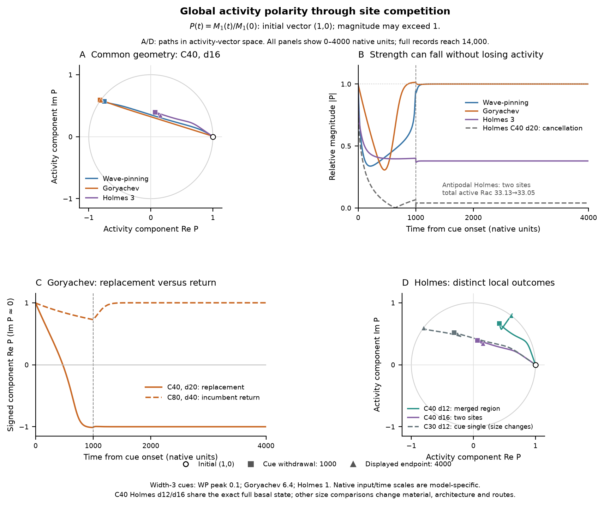

# Reusable component: global activity polarity during local competition

This component is for the expanded ring figure. It uses the eight retained histories in the [vector design and audit](../polarity1d/manuscript/figures/length_mechanisms_20261008/dev/global_polarity_vector_20261017/DESIGN.md); it does not replace the current checkpoint or introduce another main-text figure. No new integrations were performed.

## Message and why this presentation

**Local competition changes the direction and strength of whole-boundary activity asymmetry.** The common C40 d16 examples finish with cue-associated single peaks in Wave-pinning/Goryachev, but with two retained sites and a smaller resultant in Holmes. Goryachev's antipodal size pair shows replacement through a near-zero resultant versus recovery of the original vector. Holmes's same-state location pair distinguishes merger from two retained sites. These are complementary descriptions of the existing spatial histories, not new fate classifications.

Cartesian components and magnitude retain information that a heading-only plot loses. A/D show paths in **activity-vector space**; B/C show the corresponding magnitude or signed component against linear native time. Every panel displays 0–4000 units, withdrawal is at 1000, and the source records continue through 14,000. The common Cartesian range contains all displayed components; the magnitude axis extends above one. No angles are interpolated through weak resultants, no velocity is assigned, and each curve retains its relative amplitude.

**The cancellation example is part of the figure.** Antipodal Holmes C40 d20 retains two active sites while its resultant falls to approximately 0.040. Total active Rac changes only from 33.13 to 33.05. A weak first moment therefore does not establish weak activity or loss of polarity at every local site.

## Definition and interpretation

For the native primary active field, or active Rac in Holmes, define the first angular moment on the declared circular boundary:

$$
M_1(t)=\int_0^C u(s,t)\exp\!\left[\frac{2\pi i(s-s_0)}{C}\right]\,\mathrm{d}s,
\qquad
P(t)=\frac{M_1(t)}{M_1(0)}.
\tag{1}
$$

Here $s_0$ is the initial incumbent coordinate. Complex division rotates and scales the initial vector to $(1,0)$. The plotted components are $\operatorname{Re}P$, $\operatorname{Im}P$ and $R=|P|$. A spatially uniform background cancels from the moment on the complete ring. No threshold, per-frame background subtraction or per-frame normalization is used. **R can exceed one:** it is oriented activity relative to the initial incumbent, not a material fraction. Basal normalization removes absolute differences in initial incumbent activity; native initial moment and total activity remain in the [summary table](../polarity1d/manuscript/figures/length_mechanisms_20261008/dev/global_polarity_vector_20261017/supporting/data/global_polarity_summary.csv).

The first moment is not a unique reconstruction of the local pattern. Merger and separated sites can produce similar vectors, and return to $(1,0)$ alone does not prove recovery of every field or survival of a particular incumbent. Keep the local histories beside this component: [common C40 d16 kymographs](../polarity1d/manuscript/figures/length_mechanisms_20261008/dev/chemical_ring_functional_20261017/ring_functional_C40_d16_anchors.png), [Goryachev replacement/return histories](../polarity1d/manuscript/figures/length_mechanisms_20261008/dev/chemical_ring_functional_20261017/ring_functional_Goryachev_C40_C80_antipodal_history.png), and [Holmes same-state location kymographs](../polarity1d/manuscript/figures/length_mechanisms_20261008/dev/chemical_ring_functional_20261017/ring_functional_Holmes_C40_location_control.png). The declared source archives also retain the cancellation and Holmes C30 cue-single fields.

## Caption and comparison limits

**A**, relative activity-vector paths for Wave-pinning, Goryachev and Holmes at C40 d16. The gray circle marks R = 1, not a bound. **B**, their magnitudes, plus the antipodal Holmes cancellation safeguard. Its total-Rac annotation compares onset with t4000. **C**, Goryachev C40 d20 versus C80 d40; the imaginary component is numerical roundoff, so the signed real component exposes replacement versus return without defining an angle near zero. **D**, solid curves compare the exact same full Holmes C40 basal at d12 (merger) and d16 (two sites); dashed C30 d12 is a separate cue-single illustration that changes size. In A/D, open circles mark the common initial vector, squares withdrawal, and triangles t4000. A/D are descriptor coordinates, not spatial cell paths.

Every cue is a width-3 raised cosine lasting 1000 native units, followed by 13,000 cue-free units. Native peaks are Wave-pinning 0.1, Goryachev 6.4 and Holmes 1. Shared nominal geometry and clocks do not calibrate kinetic units or input strengths across models; this is a comparison of retained examples, not a ranking under equivalent biological stimulation. The Goryachev size pair changes material, incumbent architecture, both routes and angular cue width together. Only the Holmes C40 d12/d16 comparison holds the exact full basal fixed; moving the cue still changes both routes and local context. The eight-history subset was chosen with known outcomes before calculating these vectors; it is not a new prospective campaign or full-matrix vector analysis.

## Experimental readout and sources

The experimental counterpart is whole-boundary reporter asymmetry, its transient weakening and retained axis after a localized input, alongside incumbent/challenger extent, intensity and fate. Reporter calibration and geometric registration must be explicit: equal-arclength angles on a perfect model circle are not automatically boundary normals in a deforming cell. These measurements concern activity; no conversion into a cell trajectory is required.

- [All source vector samples](../polarity1d/manuscript/figures/length_mechanisms_20261008/dev/global_polarity_vector_20261017/supporting/data/global_polarity_traces.csv), [eight-history summaries](../polarity1d/manuscript/figures/length_mechanisms_20261008/dev/global_polarity_vector_20261017/supporting/data/global_polarity_summary.csv), [native archive hashes](../polarity1d/manuscript/figures/length_mechanisms_20261008/dev/global_polarity_vector_20261017/supporting/data/global_polarity_sources.csv), and [descriptor audit](../polarity1d/manuscript/figures/length_mechanisms_20261008/dev/global_polarity_vector_20261017/supporting/metadata/global_polarity_audit.json).
- [Component checks](../polarity1d/manuscript/figures/length_mechanisms_20261008/dev/global_polarity_vector_20261017/supporting/metadata/global_polarity_component_verification.json), [component provenance](../polarity1d/manuscript/figures/length_mechanisms_20261008/dev/global_polarity_vector_20261017/supporting/metadata/global_polarity_component.manifest.json), [render-only source](../polarity1d/manuscript/code/mechanisms/global_polarity_component_20261017.py), and [vector PDF](../polarity1d/manuscript/figures/length_mechanisms_20261008/dev/global_polarity_vector_20261017/supporting/vectors/global_polarity_component.pdf).

The [fresh-context critique](../polarity1d/manuscript/figures/length_mechanisms_20261008/dev/global_polarity_vector_20261017/supporting/metadata/global_polarity_component_critique.md) supports retaining this reusable component with its definition and spatial-history links. Independent sine/cosine sums reproduce all 20,108 native vectors within $3.34\times10^{-15}$; the source render is byte-identical, all displayed samples fit the stated axes, and no essential correction remains. Existing design, data, analysis code and checkpoint figures are unchanged.
