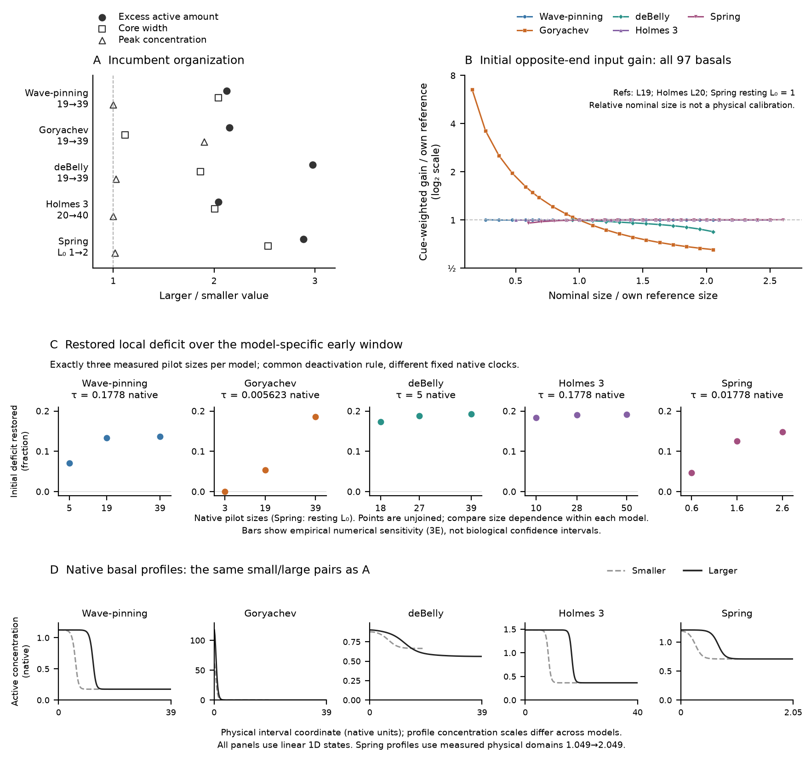
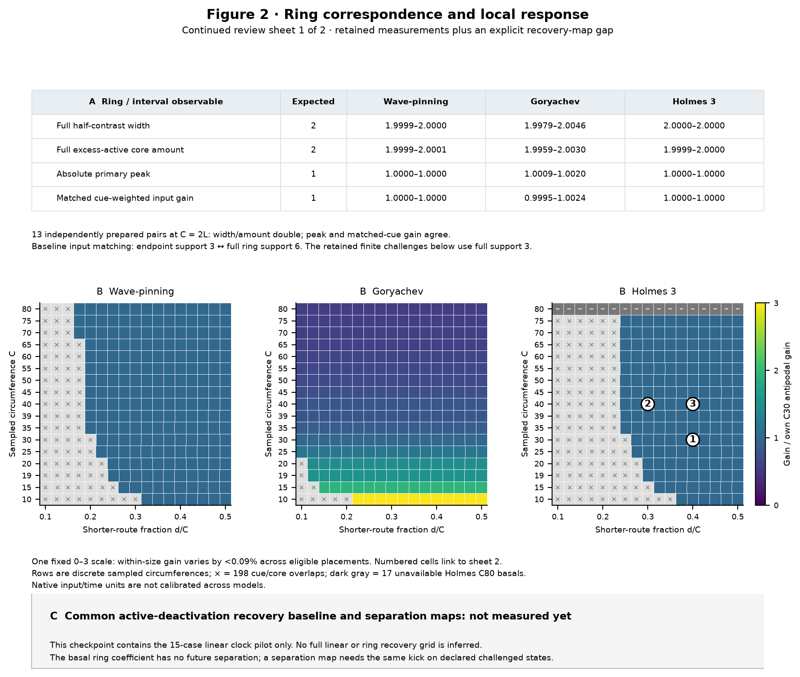
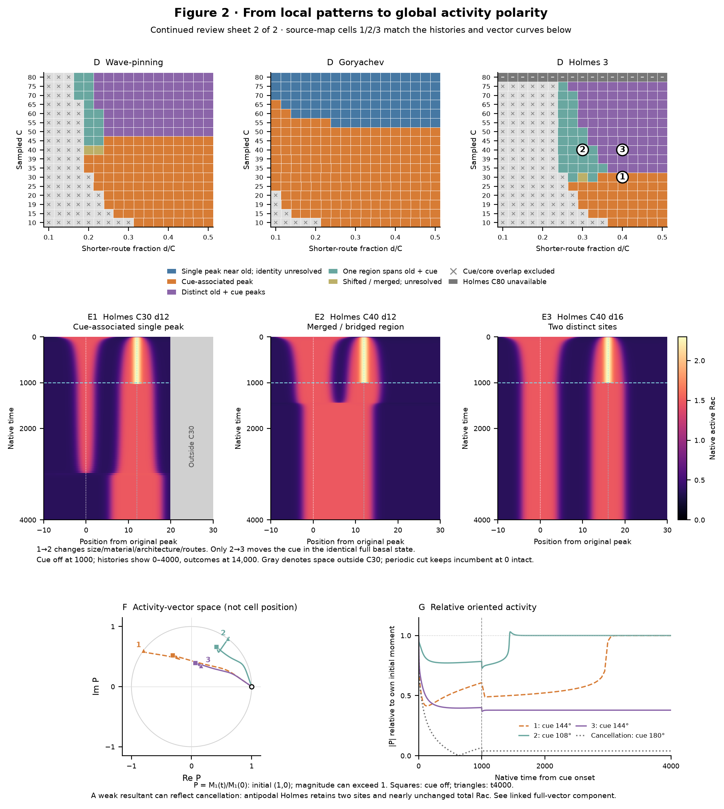

# Updated checkpoint: all-five linear responses, then ring location and global polarity

This is **one checkpoint with two figure concepts**. Figure 2 is spread over two continued review sheets so its evidence remains readable; this is not a finished publication layout. The previous checkpoint is preserved.

**Coverage is explicit:** Figure 1B includes all 97 retained linear basals; the new Figure 1C contains only 15 measured recovery-pilot basals, three per model. The equivalent new ring-recovery baseline and separation maps are **not measured yet** and remain visibly pending. No values from the older inactive-pool hold/return assay fill that gap.

## Figure 1: enlargement changes incumbent organization and native response

**Message.** All five linear models acquire more incumbent excess-active material with enlargement, through different changes in width and concentration. Their native input responses differ: Goryachev shows substantial substrate-dependent attenuation, and corrected deBelly also shows lower input gain through its Rho-dependent activation channel. Wave-pinning, Holmes and Spring change much less over the highlighted near-doubling pairs. The common active-loss pilot adds an all-five comparison of one specified regional recovery response; its size dependence is most pronounced in Goryachev and Spring across their sampled sizes.

**Why this presentation.** A retains the established all-five comparison and D shows its exact native profiles. B includes every qualified size on one shared log-fold axis, preserving Goryachev's short-cell response rather than hiding it in a selected interval. Relative nominal size includes Spring without inventing a cross-model physical-length calibration. C shows exactly three unjoined measurements per model, with their actual native sizes and distinct fixed clocks printed. Its common fractional axis avoids magnifying the small deBelly/Holmes differences. Compare size dependence **within** each model; the different clocks do not rank biochemical repair rates across models.

**A/B/D caption.** A, larger/smaller ratios of above-background active material inside the half-contrast core, core width and absolute peak concentration; these are separate observables, not an exact width × peak identity. Pairs are 19→39, Holmes 20→40 and Spring resting L₀ 1→2. D uses these same ten profiles and physical interval coordinates; Spring's measured domains are 1.048990→2.049367. All deBelly data use the corrected independent-endpoint implementation. B is cue-weighted incremental production per unit native opposing input. The gain is inactive substrate in Wave-pinning/Goryachev/Spring, inactive Rac / 7.5 in Holmes, and 0.04 / (1 + Rho²) in deBelly, which has no explicit inactive-Rac pool. End-to-zero supports are 3, or 0.2 for Spring. Each gain and nominal size is divided by its model's L19 reference, Holmes L20, or Spring resting L₀ = 1. The 19→39 gain fold is 0.65361 for Goryachev and 0.84570 for deBelly; the other highlighted folds are approximately one. Native input channels are not a biological dose calibration or challenger-establishment probability.

### What the new C measures

At each exact basal state, reduce the original incumbent's excess active profile by the same ε = 0.005 compact cosine-taper rule, frozen to its original half-contrast core. Add the removed amount pointwise to the explicit inactive pool in Wave-pinning/Goryachev/Holmes/Spring. In deBelly change Rac only; its equations have no tracked inactive-Rac pool. All other fields and controllers start unchanged and subsequently evolve natively. The sham starts from the identical complete basal without the kick; neither branch has a challenger cue. Nothing is later returned or reset.

For the fixed original core, the paired deficit and displayed restored fraction are

$$
D(t)=\int_{\Omega_0}\!\bigl[a_{\mathrm{sham}}(t)-a_{\mathrm{probe}}(t)\bigr]\,\mathrm d\ell,
\qquad
F_\tau=1-\frac{D(\tau)}{D(0)}=\tau K_\tau.
\tag{1}
$$

Spring's core is fixed in material coordinates and each evolving profile uses its own physical domain length. The observable includes native reaction, transport and domain response. Positive F means that this perturbation-induced **regional deficit relative to the sham** has shrunk; it does not establish generic stability or maintenance against an actual challenger.

| Model | Three measured native sizes | Fixed native τ | Restored fractions, in size order |
|---|---|---:|---|
| Wave-pinning | 5, 19, 39 | 0.177827941 | 0.07097, 0.13391, 0.13735 |
| Goryachev | 3, 19, 39 | 0.005623413252 | 0.000603, 0.05404, 0.18588 |
| deBelly | 18, 27, 39 | 5 | 0.17354, 0.18801, 0.19271 |
| Holmes 3 | 10, 28, 50 | 0.177827941 | 0.18347, 0.19048, 0.19114 |
| Spring | L₀ 0.6, 1.6, 2.6 | 0.0177827941 | 0.04645, 0.12566, 0.14826 |

**C caption.** One clock per model was selected by the declared prefix numerical/linearity/saturation gates and is fixed across its three pilot sizes. ε = 0.001/0.005/0.01 checks qualify the small-kick direction. Bars are three times empirical numerical sensitivity, not biological confidence intervals. The points are not a full size series or A's matched-pair folds: several pilot sizes differ from A/D. The native Goryachev L = 39 core has only four sample centers, a spatial-representation limitation retained in support. deBelly uses its native staggered 0.5-time step. [Full pilot curves](../polarity1d/manuscript/data/runs/all_five_incumbent_recovery_pilot_20261017/results/short_curves.csv), [clock decision](../polarity1d/manuscript/data/runs/all_five_incumbent_recovery_pilot_20261017/results/clock_decision.json) and [native audit](../polarity1d/manuscript/data/runs/all_five_incumbent_recovery_pilot_20261017/results/verification.json) retain K, damage, actual sham/probe changes and numerical records. The [pilot report](../polarity1d/manuscript/figures/length_mechanisms_20261008/dev/all_five_recovery_pilot_20261017/RESULTS.md) and [independent result critique](../polarity1d/manuscript/figures/length_mechanisms_20261008/dev/all_five_recovery_pilot_20261017/supporting/metadata/FRESH_RESULT_CRITIQUE.md) qualify this bounded 15-case assay.

## Figure 2, sheet 1: establish ring correspondence before varying location

**Message and why.** Linear enlargement changes incumbent architecture and end-to-end separation together. Native chemical rings let cue location vary at fixed circumference and exact complete incumbent state. The first sheet checks the baseline relationship and shows the starting response before interpreting competition. It leaves the missing same-assay recovery measurements explicit.

**Caption.** A summarizes all 13 retained C = 2L comparisons in Wave-pinning/Goryachev/Holmes. Full ring width and excess-active amount are approximately twice the corresponding interval quantities; peak and matched cue-weighted gain agree closely. These are independently prepared native basals, not byte-identical reflected states or a grid-convergence study. The matched baseline cue uses linear end support 3 and full ring support 6. The gain maps and existing finite challenges use **full ring support 3**, so their finite dose/coverage is a separate protocol. B retains all 867 planned cells: 652 complete, 198 overlap exclusions and 17 unavailable Holmes C80 preparations. Gain is divided by each model's own C30 antipodal value and displayed on a common 0–3 scale. Within-size placement dependence is less than 0.09%, so these maps should look nearly flat across a row. Numbered cells identify sheet 2's examples; rows show discrete sampled circumferences. C records the unmeasured common-recovery extension. Basal repair has no future-location variable; its location map would require the same kick on declared challenged states.

## Figure 2, sheet 2: local patterns and their global activity descriptor

**Message and why.** Almost location-independent initial gain does not imply location-independent competition. The complete outcome maps justify the three Holmes illustrations: cue-associated single peak, merger and two retained sites. Matching numbers connect their exact native histories to the activity vector and magnitude, rather than attaching an unrelated global summary.

**Caption.** D maps endpoint geography at 14,000 native units; a sole old-associated peak does not establish tracked incumbent identity or a stable branch. E1 is Holmes C30 d12; E2 is C40 d12; E3 is C40 d16, all from exact native h = 0.05 histories. Shared linear time shows 0–4000; the shared raw Rac scale is unclipped. The shifted periodic cut keeps the original site at 0 intact; gray beyond 20 lies outside C30. All use a full-support 3, peak 1 cue for 1000 units, then 13,000 cue-free units. E1→E2 changes size, material, architecture and routes. Only E2→E3 relocates the cue in the exactly identical complete four-field basal state; both routes and local context still change.

F/G use the same three histories and the first angular moment divided by its initial complex value:

$$
M_1(t)=\int_0^C u(s,t)e^{2\pi i(s-s_0)/C}\,\mathrm ds,
\qquad P(t)=\frac{M_1(t)}{M_1(0)}.
\tag{2}
$$

The initial vector is (1,0); uniform background cancels and magnitude may exceed 1. F is **activity-vector space**, not cell position. Squares mark withdrawal; triangles mark t = 4000. The nominal cue angles are **E1 144°, E2 108°, E3 144°**. Therefore E1→E2 also changes the angular input target; its different global axis cannot be attributed purely to incumbent size. G includes an antipodal 180° cancellation safeguard: two active sites remain while the resultant is approximately 0.04 and total active Rac remains nearly unchanged. No direction is assigned through a near-zero resultant. The [reviewed full vector component](global_polarity_component_20261017.md) retains all eight histories, native sources, mathematical checks and the Goryachev replacement/return comparison. A first moment is not a unique reconstruction of the local pattern; its recovery alone does not prove incumbent survival.

## Evidence boundaries and the review stopping point

The supplied PDF already establishes all-five incumbent growth, two-model substrate/hold-return mechanisms and Wave-pinning challenger collapse/return/retained reversal. The all-five B extraction uses retained native source identities; new C is a different, directly measured active-deactivation **pilot**, not the old assay renamed. The systematic ring comparisons, three-fate location context and global moment analysis extend the supplied PDF.

**Still missing:** the full linear recovery series; recovery correspondence on ring basals; and the same recovery assay after challenge across size/location. The pilot clocks require a bounded ring-port check before that grid. None is inferred here, and none is launched while this checkpoint is being reviewed. The continued sheets establish the evidence sequence for detailed feedback; they are not a claim that every requested measurement or publication layout is finished.

The experimental distinctions are incumbent extent/intensity/integrated reporter signal, early challenger response, local loss/rebound, fate and lifetime, and whole-boundary asymmetry. Molecular-amount interpretation needs reporter calibration; spontaneous-event comparisons need common detection and upstream-input accounting. These are activity measurements in migrating cells; no movement derivation is required.

- [All 97 normalized gain values](../polarity1d/manuscript/figures/length_mechanisms_20261008/dev/updated_checkpoint_20261017/supporting/data/updated_checkpoint_all_five_gain.csv), [all 15 pilot points](../polarity1d/manuscript/figures/length_mechanisms_20261008/dev/updated_checkpoint_20261017/supporting/data/updated_checkpoint_recovery_pilot.csv), and [ring component evidence](../polarity1d/manuscript/figures/length_mechanisms_20261008/dev/expanded_ring_components_20261017/COMPONENTS.md).
- [Assembly checks](../polarity1d/manuscript/figures/length_mechanisms_20261008/dev/updated_checkpoint_20261017/supporting/metadata/updated_checkpoint_verification.json), [source/output hashes](../polarity1d/manuscript/figures/length_mechanisms_20261008/dev/updated_checkpoint_20261017/supporting/metadata/updated_checkpoint.manifest.json), and [render-only source](../polarity1d/manuscript/code/mechanisms/updated_checkpoint_20261017.py). PDF/SVG exports accompany each PNG.

The [native-pilot result review](../polarity1d/manuscript/figures/length_mechanisms_20261008/dev/all_five_recovery_pilot_20261017/supporting/metadata/FRESH_RESULT_CRITIQUE.md) and [fresh-context review of these exact three renders and their sources](../polarity1d/manuscript/figures/length_mechanisms_20261008/dev/updated_checkpoint_20261017/supporting/metadata/FRESH_CHECKPOINT_CRITIQUE.md) are complete. No essential assembly correction remains. This checkpoint is ready for detailed feedback; the missing recovery measurements and final publication layout remain unresolved.
