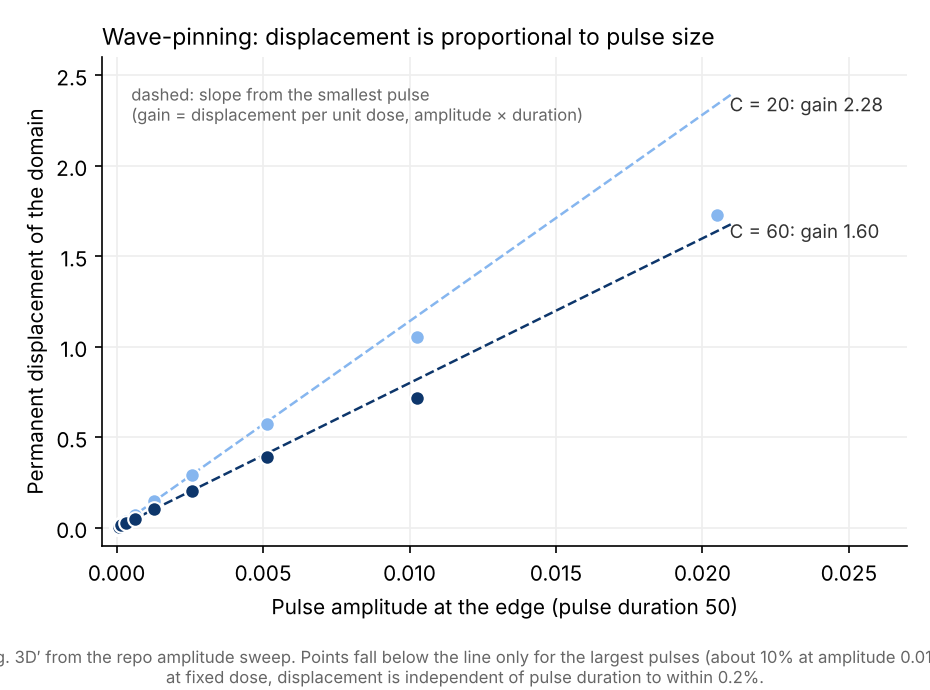
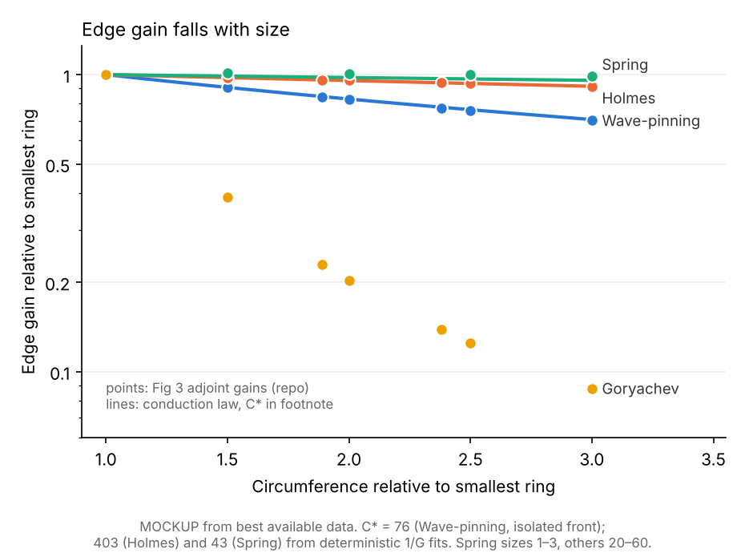
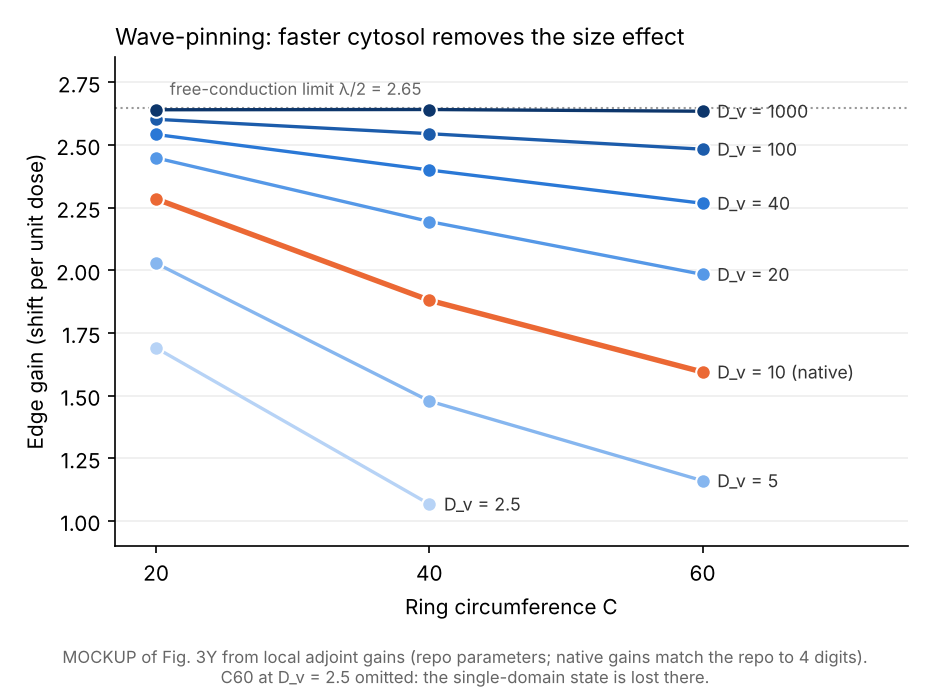
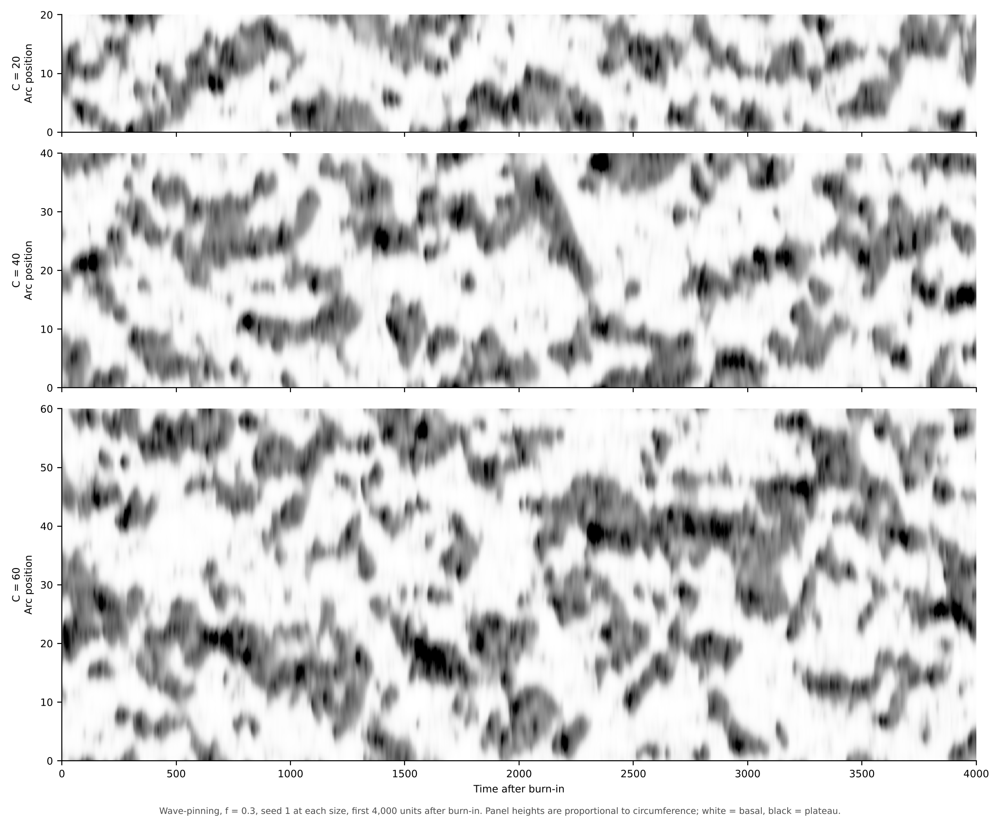
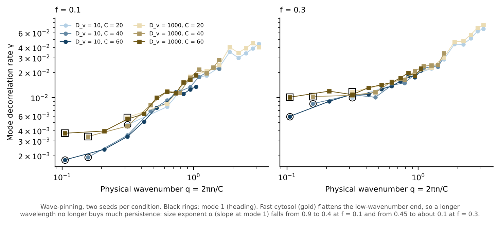

# WGD manuscript: narrative and claims target for the round-7 figure set

Oct 23, 2026 · @Richard

Across five polarity models with unchanged local kinetics, directionally polarized cells resist reorientation upon challenge by opposing cues and, under fluctuating input, maintain their heading for longer. Model analyses predict that resistance to reorientation arises through one of three routes: slower initiation of a competing domain, saturation that forces a challenger to expand, or a slow mechanical memory. They predict that persistence under fluctuating input arises by one of three routes: drift slowed by cytosolic transfer between the domain edges, which lengthens with size; competitor jumps suppressed by depletion of the inactive pool; or unchanged drift around a larger perimeter. Between the two drift routes, what decides is how the ring size compares with the model’s cytosolic conduction length. The analyses also suggest experiments to discriminate these possibilities. Regardless of the mechanism, the enhanced directional persistence predicted by all models is consistent with published migration data. Follow-up experiments in a WGD+/− cell pair are planned.

This is the target narrative for the next figure round. It builds on the round-6 figure set (outline\_v12, commit `122d306b` on `codex/round3-outline-compact-20261023`) and the pilot analyses run during its review (`pilot_analyses_round6.md`). Each section title is the claim; bullets carry figure callouts. **(not shown)** marks a step the argument needs that no panel shows. **PEDAGOGICAL** marks a panel that shows an expected result to orient the reader, not a new finding. Manuscript text and talking points are not yet vetted.

**Figure labels.** Primes mark the proposed figure set. They are a convenience, used only to keep it apart from the round-6 figures, which the “From” columns cite by their round-6 labels (3A, 4G). In the updated outline the primes go: Fig. 4′ is simply Fig. 4, Fig. 3D′ is Fig. 3D, and so on. Figs 1 and 2 are unchanged and carry no primes.

## 1. Larger cells need longer cues to reorient (Fig. 1)

- We polarized model cells of different lengths with local kinetics unchanged. A Wave-pinning example shows the finite preparation cue, the resulting activity profiles and the orientation trace, separating input duration from autonomous development (Fig. 1A–C).
- Each polarized cell was then challenged with a finite opposing cue of one of three shapes: fixed width (3 length units; Spring 0.2), width 20% of length, or a ramp of constant physical slope (Fig. 1D). Goryachev cues use a length-independent multiplier (K = 64), so the comparison is response-permissive rather than dose-matched across models.
- For each length we found the shortest tested pulse that produced lasting replacement, scored by two gates: orientation (a lasting reversal) and strength (a reversal whose magnitude returns to within 1% of the initial orientation) (Fig. 1E). The duration curves themselves are **(not shown; supplement only)**.
- Under fixed-width and proportional-width cues, the rank correlation between length and required duration was 1.0 for both gates in Wave-pinning, Goryachev, Holmes and Spring (Fig. 1E). It was weaker in deBelly (+0.29 to +0.55), whose duration curves are non-monotone. Holmes fixed-width successes extend only to L25 (orientation) and L20 (strength); longer cells did not replace within the horizon.
- Under the ramp, the length dependence was model-specific (Fig. 1E): 1.0 in Goryachev, 0.61–0.63 in Wave-pinning, 0.38–0.43 in deBelly, 0.05 (orientation) and 0.41 (strength) in Holmes, and −0.87 in Spring. Because the ramp peak increases with length (Fig. 1D, right), this comparison confounds size with cue dose.
- Only 13 of 72 deBelly scalar successes also pass the separate native-field tail check.
- The magnitude of the increase in required duration **(not shown)**.

## 2. Larger cells resist replacement by three routes, set by how each model stores the extra active material (Fig. 2)

- Larger cells contain more active material, which the models accommodate in one of two ways (Fig. 2A–C, 97 retained incumbent states). Wave-pinning, Holmes, deBelly and Spring broaden the active domain at a fixed peak. Goryachev raises its peak instead.
- **Missing step: the mechanistic basis of the two scaling modes (not shown; candidate panel: Wave-pinning vs Goryachev net-activation maps, length-mechanisms report Fig. 3).**
  - In Goryachev, the taller incumbent depletes the inactive pool: opposite-end inactive concentration falls three-fold between L9 and L39. An equal cue therefore activates one third as much material, and the local activation threshold for a challenger rises from 18 to 58.
  - In Wave-pinning, active concentration saturates at a fixed plateau and net activation is confined to the domain boundary, at a level independent of length. A challenger therefore cannot prevail by increasing its height and must instead expand.
- At reference cue area 1, replacement was 5–12-fold slower from L19 to L39 in every model wherever both lengths resolve (Fig. 2E): 4.8–8.3-fold in deBelly, 7.2–8.3 in Goryachev, 5.3–5.8 in Spring, 5.1–11.7 in Wave-pinning (the two broadest widths) and 6.6 in Holmes (broadest width only; narrower cues did not replace L39 within the horizon).
- The Goryachev constraint appears as delayed initiation, 2.9-fold slower at L39 than L19 (Fig. 2D). Initiation was independent of length in Wave-pinning, Holmes and Spring (L39/L19 ratio 1.00). deBelly initiation falls within the first native update at both lengths, so its size dependence is unresolved.
- The expansion constraint appears as a cue-width penalty (Fig. 2E). At equal cue area at L19, the narrowest cue was 3.8-fold (Wave-pinning) and 45-fold (Holmes) slower than the broadest, against 1.1-fold in Goryachev and 1.6-fold in deBelly; Spring times are too coarse to compare. Narrow cues failed within the horizon at larger lengths in Wave-pinning and Holmes. Broad cues rescue Holmes at every length, so narrow-cue censoring does not establish a width penalty that grows with size.
- Four-pulse trains distinguish three response classes, read from first-gap activity kept against the pulse-2 gain as a fraction of headroom (Fig. 2F) and from L39 challenger-share histories (Fig. 2G):
  - **Goryachev:** challenger activity collapses during each gap (median kept 0.02) and pulse 2 gains almost nothing, so each pulse must re-initiate.
  - **Wave-pinning and Holmes:** challenger activity is retained across gaps (median kept 0.95 and 0.86).
  - **deBelly and Spring:** challenger activity can fall below the visibility gate during gaps, yet pulse 2 still gains and the challenger ultimately takes over.
- Outside Goryachev, the step that slows with size is removal of the incumbent, not initiation of the challenger. Initiation was length-independent (Fig. 2D) while replacement slowed 5–12-fold (Fig. 2E), and challengers in Wave-pinning and Holmes retained their gains across gaps (Fig. 2F, G). This asymmetry, in which challengers start readily but incumbents resist removal, recurs under fluctuating input (Section 4).
- **Missing step: the state that deBelly retains across gaps (not shown; candidate panel: deBelly spring/dashpot graphic, length-mechanisms report Fig. 10).** Membrane strain and cortical flow persist after Rac activity decays, indicating a mechanical rather than chemical memory. Spring, also a mechanical model, presumably behaves similarly.
- These signatures predict distinct biosensor readouts in WGD− and WGD+ cells: pulse-train histories (Fig. 2H) and equal-dose width responses (Fig. 2I), both prospective and qualitative. Because Fig. 2G shows L39 only, the size-dependent differences depicted in H and I are **(not shown)**.

## 3. Larger cells turn more slowly (Fig. 3′)

Fig. 3′ panels:

| Panel | Content | From |
| --- | --- | --- |
| A′ | Turning kymographs, overlapping against separated cue | 3A |
| B′ | Half-turn time against cue distance, by size | 3B |
| C′ | Susceptibility map over mean profile, one size (pedagogical) | 3C–D merged |
| D′ | Displacement against pulse amplitude, Wave-pinning: what gain is, and its linearity (pedagogical) | new |
| E′ | Edge gain against size, with the conduction law | new |
| F′ | Edge gain against size at several cytosolic diffusivities | new |

Dropped from round-6 Fig. 3: 3E (edge share) and 3F (time course; its point opens the F′ text). 3G–H move to Fig. 5′.

- In Figs 1–2 the challenging cue sits opposite the incumbent, so in a larger cell it is also physically farther away, confounding size with cue distance. To ask how much that separation contributes to the effects in Figs 1–2, we held circumference fixed, placed a continuous cue at varying distances from the edge of the incumbent domain, and measured the time required to rotate halfway toward it (Fig. 3A′, B′).
- Two turning regimes emerged depending on whether the cue overlapped the incumbent domain (Fig. 3A′). An overlapping cue displaced the incumbent toward it, whereas a separated cue nucleated a second domain that subsequently replaced the incumbent. After cue withdrawal, both relaxed to a single domain at the new heading (Fig. 3A′, bottom row).
- Larger rings reoriented more slowly at every cue position in all four models (Fig. 3B′).&#32;
- Once the cue was separated from the incumbent, further separation had little effect . Distance therefore acted mainly by determining the turning regime. Goryachev was the exception, with half-turn time increasing 2–4-fold with gap and no regime change apparent.
- A weak, brief input at any position displaced the domain permanently, in proportion to dose. The displacement per dose around the ring defines a susceptibility map, computed from the linearized native model at f = 0.001 (Fig. 3C′).&#32;
- **PEDAGOGICAL.** Plotting the susceptibility map over the mean activity profile at a single size (C40) shows that only input at the two edges of the domain moves it; input in the plateau interior or the basal region moves it by essentially nothing (Fig. 3C′). Edge-localized susceptibility is expected, because the translation mode of a flat-topped domain is concentrated at its edges; the new result is how edge gain changes with size (Fig. 3E′).
- **PEDAGOGICAL.** A weak pulse at one edge displaces the domain permanently, by an amount proportional to the pulse (Fig. 3D′, Wave-pinning). The slope, displacement per unit dose (amplitude × duration), is the edge gain: 2.28 at C20 and 1.60 at C60, so the same pulse moves a larger domain less. Displacement stays on that line until pulses reach about 5–10% of the model's reference input, and at fixed dose it does not depend on pulse duration (within 0.2%). The other models behave the same way, with 10% departures at 3–25% of their reference inputs. The drift regime of Fig. 4′ (mean input f ≤ 0.01) therefore lies inside the linear range, although lognormal input excursions reach several times the mean.

  
- Boundary gain fell with size in every model, but by very different amounts (Fig. 3E′). In Wave-pinning, Holmes and Spring the decline fis well described by G ∝ 1/(1 + C/C\*), whose crossover size C\* is set by how fast the inactive species diffuses (next bullet). Goryachev's eleven-fold fall is much steeper than this law allows and needs its own explanation.

  

  *Mockup from the repo's deterministic adjoint gains; C\* for Holmes and Spring from 1/G fits across inactive diffusivity.*
- In Wave-pinning, boundary gain falls with size because of cytosolic conduction (Fig. 3F′). A weak pulse at one edge shifts both edges by the same amount, so the domain translates rather than widens. For that, the far edge must retract and release material that travels through the cytosol to the pushed edge, a path that lengthens with circumference. Speeding up cytosolic diffusion tests this directly (Fig. 3F′). As D\_v rises, the decline shrinks, and with a freely conducting cytosol the size effect disappears. Treating the cytosol as two diffusive resistors in series predicts the ring gain from an isolated front, without fitting, to within 6–9%.

  
- Holmes and Spring obey the same conduction law **(not shown)**; they differ from Wave-pinning only in where their rings sit relative to C\*, which is why their curves in Fig. 3E′ are nearly flat.&#32;
- **Known issue: the organization and narrative flow of Fig. 3′, to revisit later.** The first half of the figure (A′–B′) asks whether part of the size effect arises because larger cells hold opposing regions farther apart. Beyond setting the turning regime, distance mattered little except in Goryachev, so apparently not. The two halves also measure different responses: at the turning sizes (C30 to C47.6, Spring 2.5 to 3.97), half-turn time toward a strong cue rose 2.2–6-fold in Wave-pinning, 3.6–24-fold in Holmes, 2.8–9-fold in Spring and 2–4-fold in Goryachev. Over the same sizes, weak-input edge gain fell by only 3–15%, except in Goryachev (to 0.36). How A′–B′ connect to the weak-input half, and what the early part of the figure is for, needs rethinking; no mechanism for strong-cue turning is sought for now.
- These analyses suggest three cellular assays. First, photoactivation at offsets from straddling to separated relative to the leading-edge boundary, with half-turn time and incumbent sliding or takeover as readouts (Fig. 3A′, B′). Second, a weak photoactivation pulse at the boundary, measuring the permanent common displacement of both lateral edges (Fig. 3C′, F′). Third, fluctuations at the lateral edges and within the active plateau measured separately, since the edges should account for heading drift (Fig. 3C′). The squared ratio of boundary responses between WGD+ and WGD− cells would predict the ratio of leading-edge drift **(assumes size-independent input statistics)**.

## 4. Larger cells maintain heading longer under fluctuating input, an increase in persistence that is largest at weak input (Fig. 4′)

Fig. 4′ panels:

| Panel | Content | From |
| --- | --- | --- |
| A′ | Baseline kymographs, drift and jumps (pedagogical) | 4A |
| B′ | Baseline heading autocorrelation at C20 and C60 (pedagogical) | 4B |
| C′ | Heading correlation against lag, each model at C20, C40, C60 (plus C30, C50 if legible; Spring 1, 2, 3), weak and strong regimes | 4D (extended) |
| D′ | Kymographs in the weak and strong regimes, one model (Wave-pinning), relative arc position | 4C (reselected) |
| E′ | Local α against input, against the baseline values (conclusion) | 4E |

Dropped from round-6 Fig. 4: 4F (noise tolerance), 4I (remainder) and 4J (takeover; pending a threshold-free pilot). The drift and α predictions, closure, Goryachev jumps and the strong-input panels move to Fig. 5′.

- **PEDAGOGICAL.** Geometry alone predicts that larger cells keep their heading longer (Fig. 4A′, B′). Two simple baselines frame the data. If a domain wanders by drift with a fixed physical diffusivity, the angle it covers shrinks as the perimeter grows, so heading decorrelates at a rate proportional to 1/C²: a ring twice as large keeps its heading four times longer. If instead heading is lost by discrete jumps to a new position, enlargement increases persistence only if larger rings jump less often; jumps at a size-independent rate leave persistence unchanged with size, and jumps at a rate proportional to perimeter decrease persistence in larger rings. Baseline kymographs and their heading autocorrelations at C20 and C60 show these cases (Fig. 4A′, B′).
- In every model, at weak and at strong input, heading correlation decays more slowly in larger rings (Fig. 4C′).
- The kymographs show that input strength switches the system between two regimes (Fig. 4D′: one model, weak and strong input, relative arc position). At weak input a single domain wanders smoothly, like the drift baseline (Fig. 4A′); at strong input activity relocates in discrete jumps, like the jump baselines.
- Summarizing persistence by an exponent α, with decorrelation rate k ∝ C^−α, places each model against the matching baseline: drift predicts α = 2 and size-independent jumps α = 0. At weak input α matches the drift baseline in Holmes and Spring and exceeds it in Wave-pinning; at strong input it stays above the jump baseline in every model with resolved estimates (Fig. 4E′). Larger cells are therefore at least as persistent as geometry predicts, and often more so, with the largest increase in persistence at weak input. Fig. 5′ explains the excess.

## 5. Larger cells hold heading longer by slowed drift, suppressed jumps or geometry, and at strong input by slow cytosolic transport (Fig. 5′)

Fig. 5′ panels:

| Panel | Content | From |
| --- | --- | --- |
| A′ | Drift ratio against size, prediction overlaid | 4G + 3G |
| B′ | Predicted against observed α, pooled across models; one marker shape only (round-6 3H uses shapes for input strength f; drop them and pool over f, which the drift regime allows) | 3H |
| C′ | Drift plus counted takeovers against observed decorrelation | 4H |
| D′ | Heading-change distributions at three lags, displacement rescaled by √lag, all four models at weak and strong input | new |
| E′ | Strong-input patch-field kymographs, with patch density, width and speed against circumference | new |
| F′ | Mode decorrelation against wavenumber, native and fast cytosol | new |

- For the largest cells, physical drift of the dominant domain (Fig. 5A′) was markedly slower than the null prediction in Wave-pinning (similar or slightly off in Holmes/Spring, Goryachev has no clear drifting regime thus not qualified).
- The results are broadly in line with the expectation from our gain analysis (Fig. 5A′, prediction overlaid on measured drift). The prediction assumes a linear response, and the drift regime (mean input f ≤ 0.01) lies inside the linear range of Fig. 3D′, although lognormal input excursions reach several times the mean.
- Drift plus counted takeovers was compared with the observed heading decorrelation rate at every designed input, with unscored takeover angles bounded between 0 and 2 (Fig. 5C′). At f ≤ 0.01 the ratio was within 15% of unity in 16 of 16 Wave-pinning, 16 of 19 Holmes and 21 of 27 Spring conditions, and in none of 5 Goryachev conditions. At f ≥ 0.03 the interval contained unity in 7 of 19 Wave-pinning, 13 of 20 Holmes, 6 of 15 Spring and 13 of 24 Goryachev conditions. Heading was lost faster than even the upper bound predicts in 5 Wave-pinning and 8 Goryachev conditions; Spring was over-predicted in 6. A ratio was unavailable in 13–39 conditions per model, mostly where drift could not be measured.
- Goryachev keeps its heading by suppressing jumps rather than drift. Its domain barely drifts (Fig. 4C′), and heading changes arrive instead as discrete relocations. Heading-change distributions separate the two (Fig. 5D′; not yet run). With displacement rescaled by the square root of lag, drift collapses onto one core at every lag, whereas relocations form a tail at fixed physical displacement that does not collapse and gains weight as lag grows. At weak input Goryachev should show that tail and Wave-pinning should not. Relocations switch on abruptly with input, at f ≈ 0.004–0.005 at C20 but only at 0.025 at C60. This is the stochastic counterpart of the delayed initiation in Fig. 2D: the taller incumbent depletes the inactive pool, so competitors are harder to start and the relocations that carry heading become rarer in larger rings.
- Larger cells therefore hold heading by one of three routes, which mirror the replacement signatures of Fig. 2:

  | Route | Models | Why larger cells hold heading longer |
  | --- | --- | --- |
  | Drift suppression | Wave-pinning | Cytosolic transfer between the edges lengthens (Section 3) |
  | Jump suppression | Goryachev | The depleted pool raises the threshold for a competitor |
  | Geometry | Holmes, Spring | The same physical drift around a larger perimeter (α ≈ 2); both sit well below their conduction crossover |
- At strong input the ring no longer holds a dominant domain but a field of patches (Fig. 5E′). In Wave-pinning at f ≥ 0.1, patches are born, move, merge and die everywhere on the ring. Their local statistics (patches per unit length, width, speed) are the same at C20, C40 and C60, shown by patch density, width and speed plotted against circumference beside the kymographs (Fig. 5E′).

  
- Larger rings nonetheless keep their heading longer, because shifting activity from one side of the ring to the other requires slow cytosolic transport. Heading is the phase of the first Fourier mode of activity. The decorrelation rates of every mode at every size fall on one curve against physical wavenumber q = 2πn/C (Fig. 5F′), so α is the slope of that curve at q = 2π/C. For a purely extensive patch field the curve would be flat at low q, giving α ≈ 0. Instead it falls at low q, because moving an imbalance of activity across the ring requires transport over a distance of order C, the same conduction limit as in Section 3. When the cytosol conducts freely (D\_v = 1000), the low-q end flattens (Fig. 5F′, gold) and α falls from about 0.9 to 0.4 at f = 0.1 and from about 0.45 to about 0.1 at f = 0.3. The increase in persistence with size beyond geometry at strong input is therefore cytosolic.

  
- Holmes shows the same pattern in the existing mode rates (α about 0.8 at f = 0.1 and 0.2 at f = 0.3, with good collapse above q ≈ 0.5 and looser below), consistent with the same mechanism; its fast-cytosol test has not been run. Spring's heading rate is flat across sizes at strong input (α ≈ 0), as expected for rings far below their conduction crossover. Goryachev's mode rates collapse almost exactly against q.
- These results suggest observables for the migration experiments **(speculative)**:
  - heading autocorrelation of full-perimeter polarity activity, with coherence, in matched WGD− and WGD+ cells;
  - the physical lateral displacement of both front boundaries, where size-suppressed drift would favour Wave-pinning- or Goryachev-like behaviour and size-independent drift Holmes- or Spring-like behaviour;
  - secondary protrusion births per perimeter–time and their takeover incidence by birth distance;
  - perimeter Fourier spectra and mode correlations against physical wavenumber;
  - mobility of the inactive (cytosolic) pool, for example by FRAP, in WGD− and WGD+ cells. With the excess over geometric persistence set by C/D, measured mobility and perimeter predict whether enlargement increases persistence by more than geometry alone.

  If secondary protrusions rarely take over and edge fluctuations are size-independent, the models predict persistence rising roughly with the square of size, about 1.6-fold per WGD.

## 6. Published migration data fit greater persistence in enlarged cells (Fig. 6′)

Fig. 6′ is round-6 Fig. 5, renumbered; its panels are unchanged.

- Enlarged or polyploid groups were not consistently faster, but they showed greater late-lag displacement or more direct migration (Fig. 6A′). Xuan: lower sampled speed (0.64-fold) with greater late-lag MSD (2.08-fold). Mallin: shorter path length (0.52-fold) with greater directness (3.12-fold). Hosny baseline PACCs: greater median path length (1.77-fold) and directness (1.67-fold). The nine source summaries are distinct measures and are not interchangeable.
- In Xuan, the population MSD of the enlarged group was initially lower but exceeded the reference group beyond about 2.32 h, the profile expected for slower but more persistent motion (Fig. 6B′).
- Ornstein–Uhlenbeck fits inferred longer velocity memory in all five primary comparisons (pooled persistence fold about 15.8; Fig. 6E′), and the fold stayed above one across the declared prior and pooling scenarios (Fig. 6F′). The Jemaà comparisons constrain speed alone, so their persistence depends on the hierarchy and priors.
- The fit does not reproduce the shape of the Xuan curves: the fitted OU curves cross near 1.11 h rather than 2.32 h, and windowed log–log slopes show the remaining curvature mismatch (Fig. 6B′, lower). The inferred fold is therefore conditional on the model.
- The comparisons span stable tetraploids, giant polyploids and treatment-induced PACCs, so they do not establish that enlargement alone causes persistence.

## 7. New WGD motility experiments (Fig. 7′, reserved)

Reserved for the SUM-159 chemically induced WGD+/− motility assays (Speros collaboration); no data are yet available. The proposed panels cover the experimental context, representative tracks, motility summaries (speed, path length, directness, lag-dependent MSD) and the size–migration relationship.

## What the set doesn't yet support

- **The bridges from Figs 2–3′ to Figs 4′–5′ are mechanistic, but no panel shows them yet.** Wave-pinning: the cytosolic conduction that lowers boundary gain (Fig. 3′) also sets weak-input drift and the strong-input low-q rates (Fig. 5′). Goryachev: the pool depletion that slows initiation (Fig. 2D) suppresses the jumps that carry heading. Holmes and Spring: no bridge is needed, since their persistence follows geometry. Proposed panels carry them: Fig. 3E′–F′ and 5E′–F′, with the heading-change distributions (Fig. 5D′) still to run.
- **The strong-input explanation is complete only for Wave-pinning.** Holmes needs its fast-cytosol mode-rate test, Goryachev its heading-change distributions (Fig. 5D′). Why the mode-rate curve has the shape it does (beyond its low-q fall) is not derived.
- **Magnitude (not shown).** At α ≈ 2, a single WGD (a 1.26-fold increase in circumference) would reduce the rate of heading decorrelation only about 1.6-fold, whereas the pooled published OU persistence fold is about 15.8.
- **The connection between simulated heading persistence and migration persistence remains a hypothesis.**
- **The figures do not support** claims that distance matters beyond determining the turning regime, or that multiple domains cause the decline in α.
- **Figs 3′–5′ propose measurements only in text.** Unlike Fig. 2H, I, no panel shows a predicted readout. The text proposes straddling versus separated photoactivation with half-turn time, the boundary displacement after a weak pulse, physical drift of both front boundaries, takeover incidence by birth distance, perimeter Fourier spectra and cytosolic-pool mobility.

## The thread in one paragraph

Across five models, larger cells need longer cues to reorient and resist replacement through distinct initiation, cue-width and pulse-memory signatures (Figs 1–2). Larger rings turn more slowly toward strong cues, and their boundaries respond less to weak input because material must cross a cytosolic path that lengthens with size; this matters where the ring approaches the conduction length, as in Wave-pinning, and little in Holmes and Spring (Fig. 3′). Under fluctuating input larger cells keep heading longer (Fig. 4′), by three routes: drift slowed by cytosolic conduction (Wave-pinning), jumps suppressed by pool depletion (Goryachev), or the same drift around a longer perimeter (Holmes, Spring). The increase in persistence with size narrows as input strengthens and activity breaks into an extensive patch field; what remains is set by slow cytosolic transport of whole-ring imbalance (Fig. 5′). Published migration data show the greater persistence this would predict, conditional on the OU fits (Fig. 6′).
