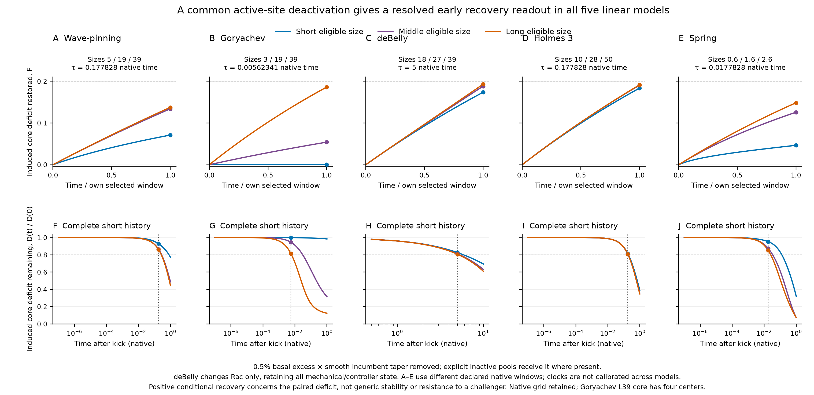

# All-five linear active-site recovery pilot

**Result.** The same localized activity-loss question gives a numerically resolved, amplitude-consistent early response in all five retained linear models. Goryachev shows the largest middle-to-long increase. The other models change more modestly over those pilot pairs; broadening alone does not imply the same functional response.

**Message conveyed.** A small incumbent-targeted activity reduction can be compared across models without pretending deBelly has an inactive Rac pool. The resulting deficit shrinks at every selected clock in all 15 native cases. This supplies a candidate all-five Figure 1 C readout. It is not an all-length result or a universal stability law.

**Why this figure.** The early traces display the actual quantity summarized by the coefficient on one shared restored-fraction scale. The complete short histories show how the deficit continues to shrink beyond the selected early window and why later clocks exceed the 20% range. Their logarithmic time axes do not establish accelerating recovery. Both panels retain short, middle and long cases. Error bands are shown but are smaller than line width. Different selected windows do not calibrate native rates across models; compare size effects within a model.

## Selected finite-window responses

The coefficient is

\[
K_{\tau}=\frac{D(0)-D(\tau)}{\tau D(0)}.
\tag{1}
\]

Here D is the difference between separately evolved sham and probe active amounts inside the frozen original half-contrast core. Its native inverse-time units differ across models. Each model uses one window for all three sizes and all amplitudes. The final column compares long versus middle **at the same within-model clock**, not models against each other.

| Model | Short / middle / long nominal size | Selected τ, native time | Kτ: short / middle / long | Long / middle Kτ |
|---|---|---:|---|---:|
| Wave-pinning | 5 / 19 / 39 | 0.17782794 | 0.3990696 / 0.7530571 / 0.7723485 | 1.02562 |
| Goryachev | 3 / 19 / 39 | 0.0056234133 | 0.1072597 / 9.610627 / 33.05496 | 3.43942 |
| deBelly | 18 / 27 / 39 | 5 | 0.03470849 / 0.03760207 / 0.03854101 | 1.02497 |
| Holmes 3 | 10 / 28 / 50 | 0.17782794 | 1.03172 / 1.071124 / 1.074884 | 1.00351 |
| Spring | 0.6 / 1.6 / 2.6 | 0.017782794 | 2.612329 / 7.06636 / 8.337228 | 1.17985 |

For WP and Goryachev the middle/long pair is 19 → 39, matching Figure 1 A. Other pilot pairs are deBelly 27 → 39, Holmes 28 → 50 and Spring L₀ 1.6 → 2.6; they must not be relabelled as Figure 1 A's highlighted pairs. The full all-97 C campaign has **not** been launched. All-five initial cue gains are separately available from existing states in the [design evidence](../all_five_linear_function_20261017/DESIGN.md).

At the selected clocks, all primary changes exceed three times the empirical sensitivity estimate. Maximum prefix sensitivity is below 2.33 × 10⁻⁷, against the fixed 10⁻⁵ limit. All selected prefix saturation and amplitude-linearity checks pass. Actual probe core changes are positive in all 15 cases, while sham changes are zero to roundoff except the small deBelly L18 basal drift (4.17 × 10⁻⁷ active amount over 5 s). In later challenged-state tests this need not remain true: a positive conditional coefficient alone cannot establish net maintenance during competition.

## Intervention and interpretation

The [frozen design](../../../../data/runs/all_five_incumbent_recovery_pilot_20261017/frozen_sources/figures/length_mechanisms_20261008/dev/all_five_linear_function_20261017/DESIGN.md) defines a raised-cosine taper anchored to the original basal half-contrast core, multiplied by its excess-active profile. Epsilon = 0.005 attenuates local basal excess by at most 0.5%; sensitivities are 0.001 and 0.01. Epsilon is not an identical integrated fractional core damage across models. WP/G/H/Spring transfer the removed amount pointwise to their explicit corresponding inactive pool. deBelly removes Rac activity alone; Rho, MCA and all mechanical and endpoint-controller fields start unchanged. Native coupled dynamics then evolve with zero extra cue, without clamps, field freezes or later material return.

The perturbation is sampled at native nodes or finite-volume centers. An edge finite-volume cell can straddle the interpolated core edge, so the full-domain and outside-core differences are exported separately. Local recovery includes reaction and transport, not only molecular reactivation. Spring's core stays fixed in material coordinates, with sham and probe each integrated using its own evolving physical length. deBelly's native half-second stagger and 0.98 endpoint relaxation remain unchanged. Its dense reference tests arithmetic of this same discrete update; it does not establish temporal convergence.

## Complete clock and failure record

Continuous candidate clocks are exactly logspace(−6, 0, 25); deBelly candidates are 0.5, 1, 2, 5 and 10 s. All candidates are sampled, with a denser continuous history and every native deBelly half-step. Every sampled prefix through a candidate must satisfy empirical sensitivity E ≤ 10⁻⁵, pairwise 5% amplitude agreement with a 3E allowance, and |F| + E ≤ 0.2. No minimum effect is required. The largest passing clock is selected once per model.

Counts below are **case × candidate** exclusions over the complete prescribed list; overlapping failures would count in more than one column. All exclusions here arise from exceeding the early-response range, rather than numerical or linearity failures. They are not failures of native polarization or eventual repair.

| Model | Error exclusions | Linearity exclusions | Saturation exclusions |
|---|---:|---:|---:|
| Wave-pinning | 0 | 0 | 7 |
| Goryachev | 0 | 0 | 16 |
| deBelly | 0 | 0 | 3 |
| Holmes 3 | 0 | 0 | 9 |
| Spring | 0 | 0 | 17 |

The selected clocks are pilot decisions for later root review. A ring port must check the extended size range and challenged states before treating these clocks as portable. No per-size or separation-specific clock adjustment is allowed.

## Verification, provenance and limits

All 15 exact source checkpoint hashes, the 97-case selection table, nonnegative kicks, conservative compensation where defined and untouched other initial fields were checked before freezing. Zero-kick executions reproduce the same sham fields exactly. Both Holmes pools, WP/G/Spring active-plus-inactive material and deBelly bound-plus-unbound MCA were tracked. Maximum pool drift was 8.44e-15. All deBelly banded and independent dense solves passed the scaled linear residual criterion (maximum 2.05e-16); all 11 field/controller differences are retained.

Native meshes are unchanged. Goryachev L39's interpolated core contains only four sample centers; its response is a result of that retained discretization, not a mesh-convergence result. No mesh campaign was added to this pilot.

SLURM array 21125088 completed the scientific integrations for all 15 cases. The three Spring workers saved complete scientific archives and then failed while serializing NumPy-int32 LSODA counters. A separate [hashed metadata-recovery audit](../../../../data/runs/all_five_incumbent_recovery_pilot_20261017/results/completion_metadata_recovery.json) reconstructed all ten trajectories per affected case, recomputed moving-domain amounts/native RHS rates and pool checks, verified unchanged archive hashes and independent zero-kick identities, and preserved the original failed statuses/error logs. No integration was repeated. Those original solver counters are unavailable; no values were invented. LSODA's stored t = 0 polynomial output differed from the exact supplied restart by at most one machine ulp (2.23 × 10⁻¹⁶), included in the roundoff allowance.

- [Selected 15-case table](supporting/data/all_five_recovery_pilot_selected.csv), [all short curves](supporting/data/all_five_recovery_pilot_short_curves.csv), and [every candidate gate](supporting/data/all_five_recovery_pilot_candidate_gates.csv).
- [Clock decision](supporting/metadata/all_five_recovery_pilot_clock_decision.json), [full verification](supporting/metadata/all_five_recovery_pilot_verification.json), and [metadata recovery](supporting/metadata/all_five_recovery_pilot_completion_metadata_recovery.json).
- [Frozen run manifest and sources](../../../../data/runs/all_five_incumbent_recovery_pilot_20261017/manifest.json), [original job launch](../../../../data/runs/all_five_incumbent_recovery_pilot_20261017/launch.json), and [native full-field archives](../../../../data/runs/all_five_incumbent_recovery_pilot_20261017/workers/).
- [PDF](supporting/vectors/all_five_recovery_pilot_curves.pdf) and [SVG](supporting/vectors/all_five_recovery_pilot_curves.svg).

**Stopping point:** the bounded pilot is complete. Root review and fresh actual-result critique precede any full grid or updated main-text coefficient claim. No migration model or deBelly ring extension was run.
