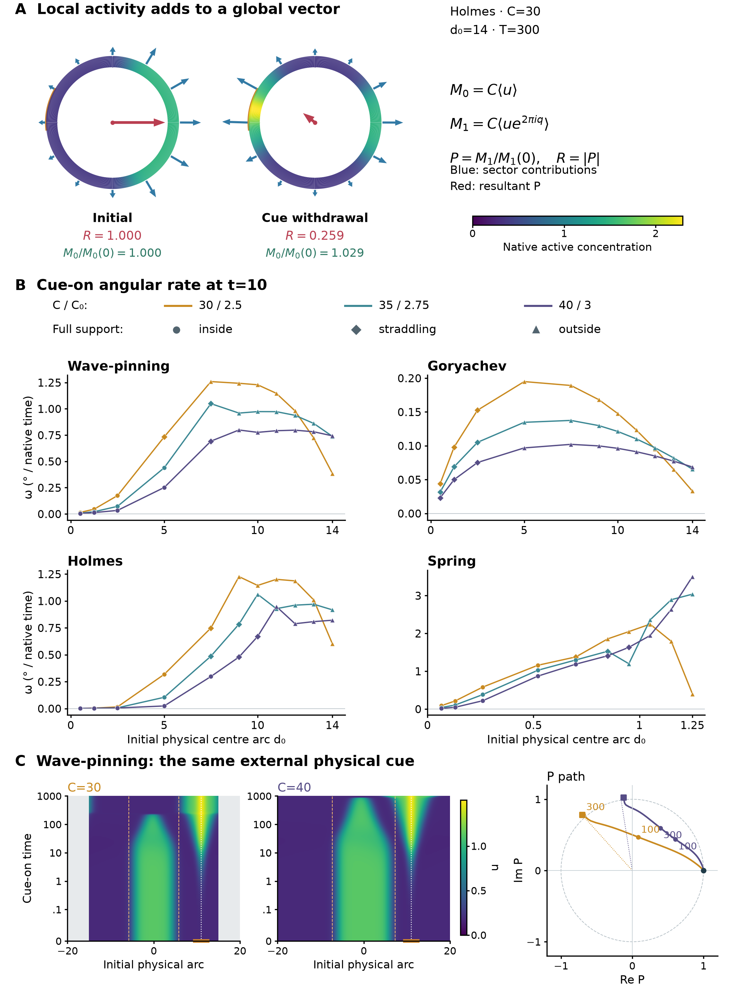
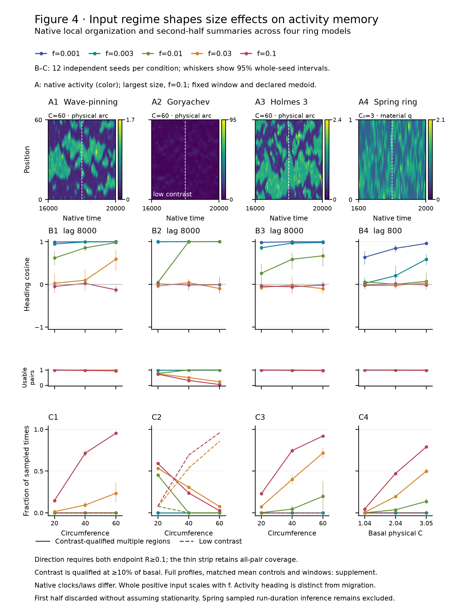

# Figures 2–4: consolidated figure set, 19 October 2026

[**Main figures and standalone legends — six-page PDF**](consolidated_figure_set_20261019/figures_2_4_main.pdf) · [**Comprehensive supplement — 64-page PDF**](consolidated_figure_set_20261019/figures_2_4_supplement.pdf) · [**Figure reader and reconstruction links**](consolidated_figure_set_20261019/index.html) · [Editable legends](consolidated_figure_set_20261019/LEGENDS.md).

The three selected main plates and their underlying experiments are complete and independently checked. The author requested autonomous consolidation after the recorded feedback. This selection develops that brief; it does not imply author acceptance or a completed manuscript. Figures 1, 5 and reserved Figure 6 retain their preceding content. Earlier drafts remain dated development evidence.

| Figure | Completed experiment | Selected main argument |
|---|---|---|
| **2** | Five linear models, **97 qualified model–length states**, three widths, five strength levels at the middle width and five native withdrawal times. **3,492 core protocols + two targeted withdrawals.** | Retain incumbent amount, extent and peak; compare how broadening changes incumbent-loss latency across lengths; explain one deBelly activity/motion contrast. |
| **3** | Four ring models, three narrowly spaced circumferences and denser physical cue distances: **645 protocols, 129 placements**. | Define the measured complex activity vector, foreground early reorientation rates and distinguish internal/straddling/external cues. |
| **4** | Nine whole-signal noise scales, three sizes, four models: **936 core cases**, plus **26 separate Goryachev transition cases**. | Link local noise regimes to activity-heading memory, usable-pair coverage and spatial organization across sizes. |

## Figure 2 — incumbent organization and cue compensation

**A–C** retain the established amount/extent/peak foundation, with all 97 qualified basals visible. **D** shows the new all-length broad/narrow latency comparison for 50% loss of localized incumbent excess at equal native peak: 75 observed pairs and twelve one-sided bounds. Six initially overlapping conditions are excluded explicitly; four pairs enter neither threshold. Event brackets and all measurement sensitivities remain in the supplement. **E–G** show the deBelly L39 example: a broader cue raises challenger Rac yet delays early endpoint motion and incumbent loss; motion later catches up. Native coupled tension and endpoint response add mechanistic context without assigning an isolated cause.

[Main caption and measurement methods](figure2/compensation_print_candidate_20261019/README.md) · [Complete campaign reading guide](figure2/five_model_compensation_20261019/README.md) · [Five-page comprehensive supplement](figure2/five_model_compensation_20261019/supplement/README.md) · [Full deBelly time courses](figure2/debelly_width_timecourse_card_20261019/README.md).

Coverage is Wave-pinning 20 lengths (5–39), Goryachev 21 (3–39), Holmes 23 (10–50), Spring 21 resting lengths (0.6–2.6) and corrected linear deBelly twelve (18–39). The width and amplitude arms share the middle-width baseline; this is not a full width-by-amplitude factorial. All five native withdrawal times are tested at every selected input. The 53 failed finite field tails remain distinct from scalar outcomes. All 97 no-cue incumbents remain stable under the localized-excess conventions. Both targeted deBelly T500 withdrawals return, while selected longer pulses retain replacement: cue-on weakening alone does not determine fate.

The main is deliberately selective. Complete width/strength/duration outcomes, raw and excess definitions, region/floor/threshold sensitivity, finite tails and full histories supply the supporting evidence. Cross-model cue coefficients, widths and clocks are native quantities rather than calibrated optical doses.

## Figure 3 — stationary cue placement and activity-vector reorientation

**A** constructs the complex vector from actual local activity; the Holmes example preserves nearly the same amount while its resultant falls. **B** foregrounds instantaneous global angular rate at native time 10 for all 129 placements, with size colors and initial footprint classes. **C** connects Wave-pinning native fields at common external physical distance to equal-scale vector paths. Geometry changes with circumference, so target angle and incumbent organization remain part of that comparison.

[Main caption](figure3/narrow_arc_experiment/main_plate/CAPTION.md) · [Interactive report](figure3/arc_review/index.html) · [Complete 645-condition supplement and four native-profile appendices](figure3/narrow_arc_experiment/supplement/index.html) · [Compact reconstruction](figure3/narrow_arc_experiment/RECONSTRUCTION.md).

Chemical circumferences are 30/35/40; Spring resting circumferences are 2.5/2.75/3. Several complete cue footprints lie outside the incumbent across every size. Internal and straddling cues remain explicit. All 645 requested protocols are accounted for; finite-tail status is **620 pass, eight Holmes fail, 17 unavailable**. The comprehensive support includes all duration/time outcomes, edge sensitivity and native profiles: 22 pages in the combined supplement and four separately linked 15-page profile atlases. Early global resultant rate includes geometric and magnitude effects; it is not local peak speed or cell velocity. Finite two-region endpoints do not prove asymptotic coexistence.

## Figure 4 — input regime, circumference and heading memory

**A** uses short native kymographs from the declared second half of each run, with exact profile snapshots linked in the supplement. **B** measures heading autocorrelation with usable-pair coverage and whole-seed uncertainty across sizes. **C** distinguishes qualified multiple-region occupancy from low-contrast states. All nine input scales and all sizes remain in comprehensive temporal, organization and native-profile panels.

[Main caption](figure4/main_plate_20261019/CAPTION.md) · [Complete core supplement](figure4/signature_assembly_20261019/README.md) · [Measurement definitions and qualification](figure4/SIGNATURE_METHODS_20261019.md) · [Portable reconstruction](figure4/portable_reconstruction_20261019/README.md) · [Targeted Goryachev transition](figure4/gory_transition_refinement_20261019/README.md) · [Exploratory endpoint-concurrency analysis](figure4/endpoint_concurrency_20261019/README.md).

The core contains **816 noisy realizations, 108 matched-mean controls and twelve no-input controls**. The central five strengths have twelve seeds per model/size; the four outer strengths have two, with uncertainty unavailable there. The whole positive input signal scales, as agreed. The added 26 Goryachev cases refine the large-cell transition: no resolved competing-region window appears at 0.015 or 0.02, and the sharp change remains between 0.02 and 0.03. A narrower unresolved interval remains possible. These cases are separate from the 936-case core summaries.

The combined supplement contains 35 Figure 4 pages. Exploratory organization and endpoint-distance tables remain linked support. Spring's original sampled-region-duration failures are preserved; accepted occupancy/vector/memory results do not establish continuous region lifetimes or competitor-establishment rates. The second-half window is declared, not a stationarity proof. Activity-heading memory motivates comparison with free migration without imposing a cell-velocity law.

## Delivery and further work

All three figure agents have completed their bounded experiments, presentation refinement, comprehensive support and compact redraw checks. Native archives are retained locally; compact inputs reproduce current artwork without them. [Assembly inputs and page inventory](consolidated_figure_set_20261019/supporting/metadata/assembly.json), [measurement continuity](consolidation_20261019/MEASUREMENT_CONTINUITY.md) and the [scientific requirement audit](supporting/metadata/REQUIREMENT_EVIDENCE_AUDIT.json) record provenance and limits. Final assembly, storage inventory and scoped Git delivery are tracked in [WORK_STATUS.json](supporting/metadata/WORK_STATUS.json).

Further scientific extensions include calibrated optical input mappings, finer withdrawal thresholds and continuous region-lineage measurements. They are distinct from completion of the present requested figure set. The first 20:20 UTC selection and intermediate decisions remain in the dated development records.
