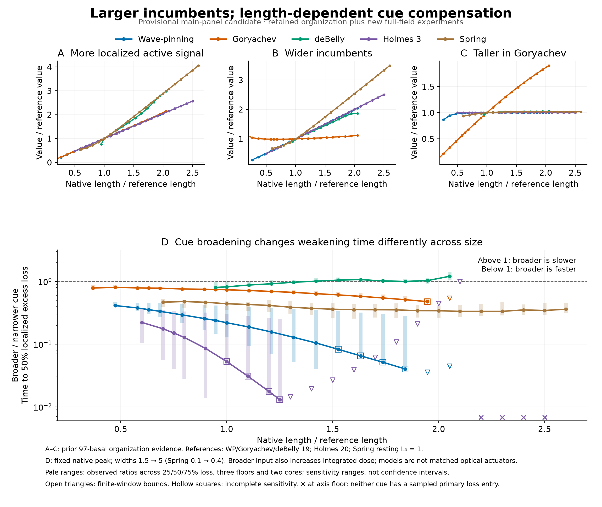

# Provisional Figure 2 compensation candidate

[PDF](supporting/vectors/figure2_compensation_candidate.pdf) · [Caption and limits](CAPTION.md) · [All width comparisons and sensitivity](supporting/data/width_response_all_conventions.csv).

The organization panels are prior evidence. The response comparison is new full-field cue experimentation, not a repeat of the optimized reversal-duration plot. Main presentation and explanatory native examples remain under review; this candidate preserves all earlier artwork.
