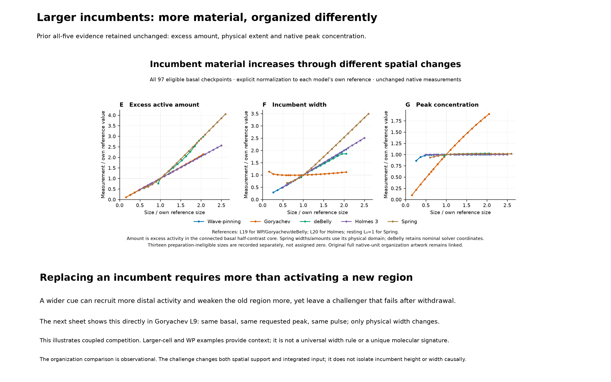
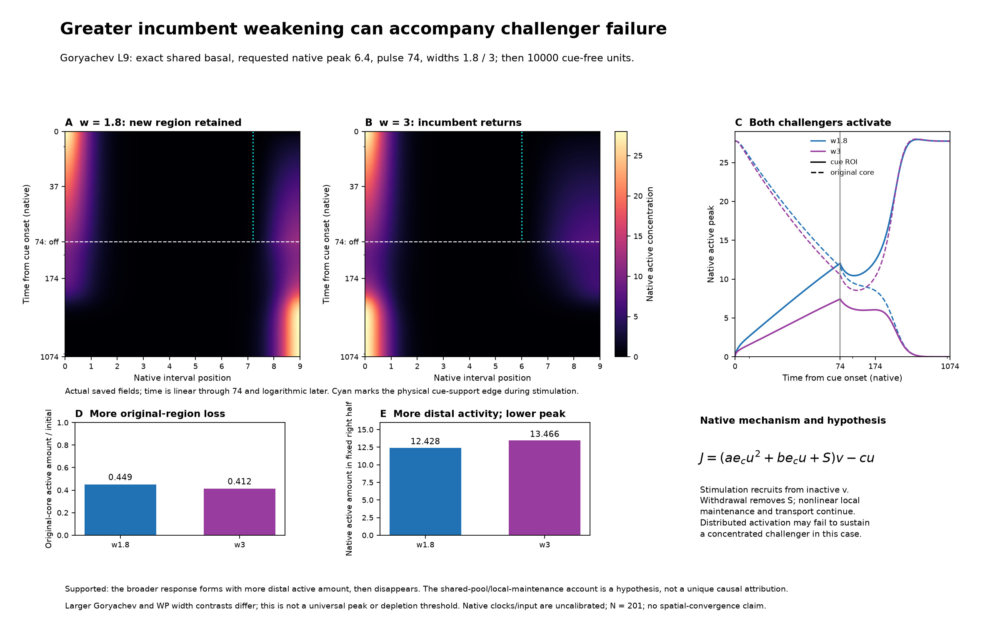

# Coupled competition: compact Figure 2 review candidate

[Two-sheet PDF](supporting/vectors/figure2_coupled_competition_candidate.pdf) · [One claim / observable / evidence / hypothesis](CLAIM.md) · [Exact eight-case context](supporting/data/coupled_width_readouts.csv)

This is a separate result-led candidate for author steering, not an accepted final layout. Prior artifacts remain unchanged. Heatmaps show selected actual saved frames through 1000 units after withdrawal; retained outcome and source fields extend through 10000 cue-free units. Kymographs are linear through withdrawal at 74 and logarithmic later. Source fields were saved every 0.1 unit during stimulation and 0.25 unit after withdrawal; displayed heatmaps use 0.5 / 2.5-unit saved-frame intervals.
