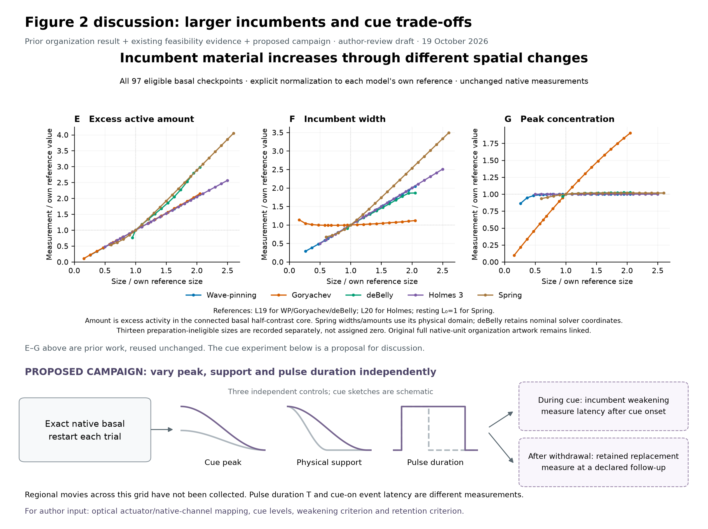
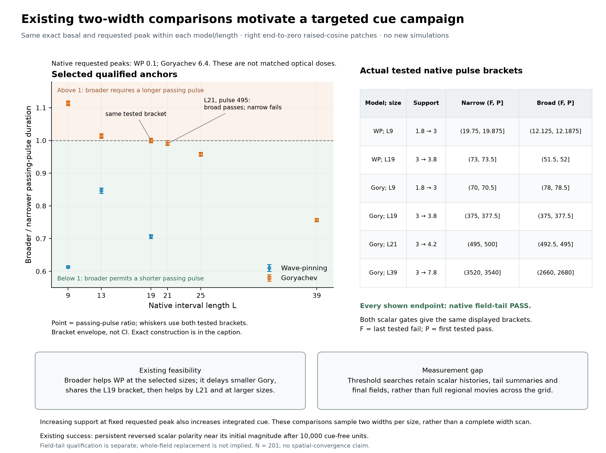

# Figure 2 cue-campaign discussion

A two-page author-review draft, not a finished main-figure claim. No new native integration.

[Two-page PDF](supporting/vectors/figure2_cue_campaign_discussion.pdf)

Page 1 retains the prior all-five E–G organization artwork unchanged and proposes independent cue peak/support/duration controls. Dashed outcome boxes are proposed regional measurements, not completed grid coverage. Page 2 uses a few audited two-width anchors and exact tested fail/pass brackets; the ratio whiskers are bracket envelopes, not confidence intervals. The proposed optical actuator and regional weakening/retention criteria remain for author input.

[Exact selected brackets and source identities](supporting/data/selected_width_brackets.csv) · [Caption](CAPTION.md) · [Source and artifact hashes](supporting/metadata/validation.json) · [Original native-unit organization art](../../../../../../../../current%20manuscript%20figs/initial_polarity_length.png)
