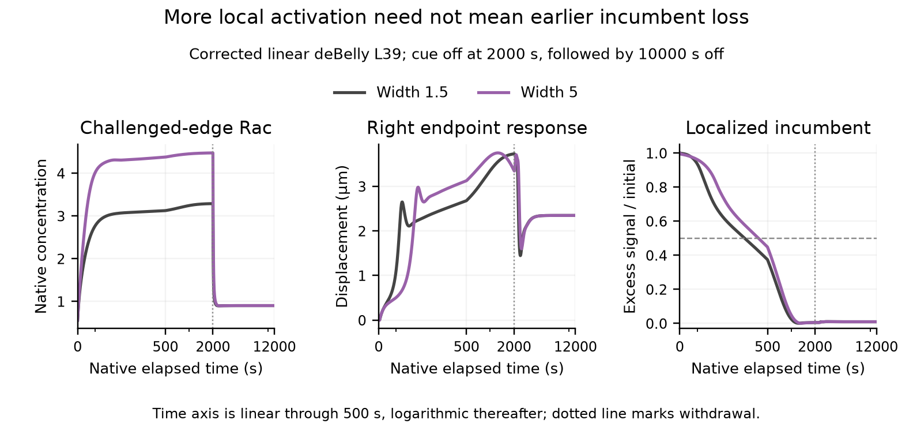

# Native explanatory pair: corrected linear deBelly

[PDF](supporting/vectors/debelly_L39_width_card.pdf) · [Caption](CAPTION.md) · [Complete compact native timecourses](supporting/data/native_timecourses.csv) · [L18 contrast](debelly_L18_width_support.png).

The display is a candidate explanatory card, not an isolated mechanical ablation or a final figure composition.
