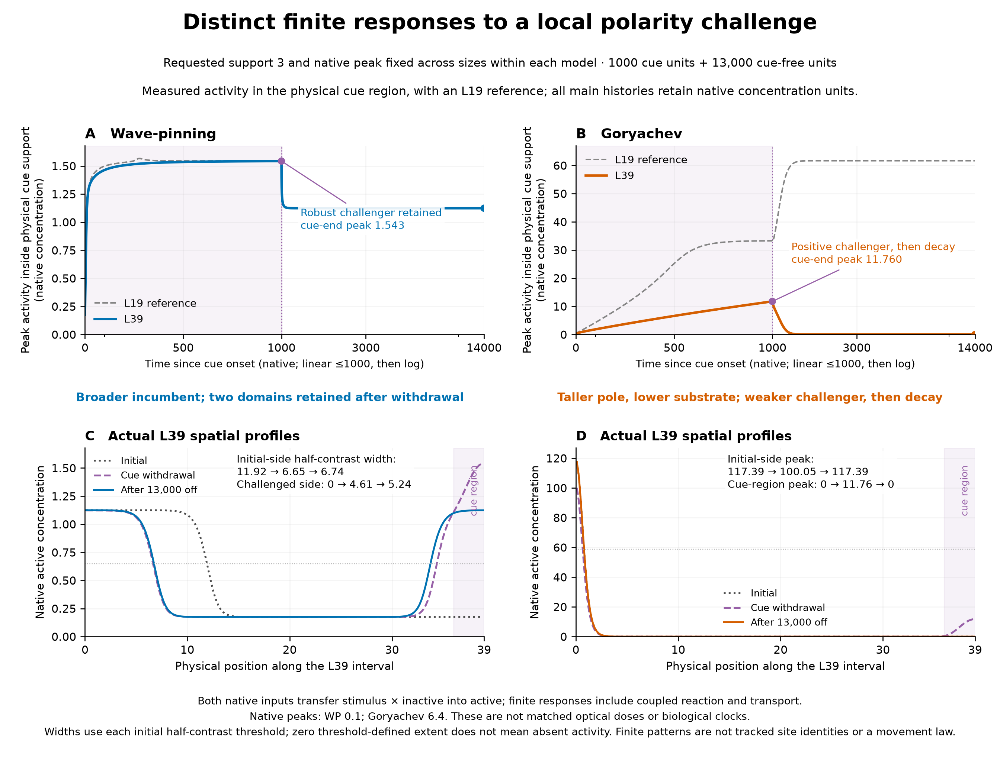
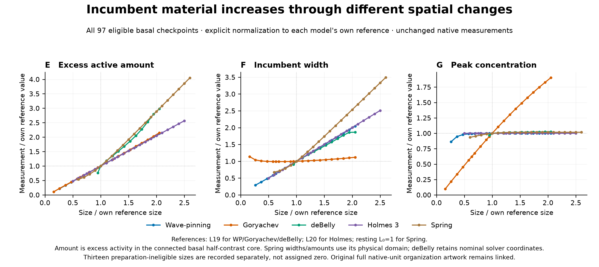

# Provisional Figure 2: finite responses first

This separate candidate follows the stated provisional finite-response-first emphasis. It is for author review, not author acceptance; the preceding prototype and all retained sources remain unchanged. No new integration was run.

Read **A–B** for actual challenger activity during and after the fixed local cue: WP reaches almost the same challenger height at both sizes; Goryachev L39 develops a positive but smaller response that decays after release. **C–D** show what remains spatially: WP L39 retains two active domains, whereas Goryachev L39 restores its initial-side pattern. **E–G** restore the all-five starting-state comparison: active amount grows, chiefly through width in four models and peak height in Goryachev. The labels connect those organizations to conditional native-channel predictions; they do not uniquely identify a molecular mechanism.

[Two-sheet PDF](supporting/vectors/figure2_finite_candidate.pdf) · [Finite-response SVG](supporting/vectors/figure2_finite_response.svg) · [Organization SVG](supporting/vectors/figure2_organization.svg) · [Caption](CAPTION.md)

The local native curves expose a positive Goryachev L39 challenger that was visually faint on the prior full-field colour scale. The selected endpoint fields distinguish WP L39's co-retained domains from Goryachev L39's incumbent return. L19 is a same-protocol within-model reference, not a matched cross-model optical stimulus. The restored all-five organization comparison makes peak-size differences visible alongside amount and width.

[Original unchanged all-five native-unit organization artwork](<../../../../../../../../current manuscript figs/initial_polarity_length.png>) · [Exact 97 basal source values](supporting/data/organization_all97.csv) · [Unavailable preparations](supporting/data/preparation_unavailable.csv)

[All four native histories and regional/edge reads](supporting/data/finite_native_readouts.csv) · [L39 native profile snapshots](supporting/data/native_profile_snapshots.csv) · [Protocols, native archives and separate full-field checks](supporting/data/selected_cases.csv) · [Validation/source hashes](supporting/metadata/validation.json)

Supporting evidence stays linked: [finite-window and amplitude audit of small-loss recovery](../optogenetic_revision/discussion_sheet/README.md), [analytic native gain and common recovery data](../supporting/data/all97_gain_recovery.csv), [endpoint-qualified evolved interventions](../supporting/data/selected_evolved_interventions.csv), and the [retained WP L15 short/long withdrawal illustration](../../../../revision_20261010/editorial/assets/wave_pinning_withdrawal.png). In that latter pair both cue-end domains remain inside support 3; only the longer-pulse domain expands beyond the cue after withdrawal. It is a one-size duration illustration, not a size comparison.

The selected WP mobility intervention improves retained orientation at a fixed dose but both native and 4× conditions fail the stronger full-polarity-strength gate; diffusion changes during cue plus recovery. None of these supporting controls provides an additive allocation of the shared reversal-size trend.
