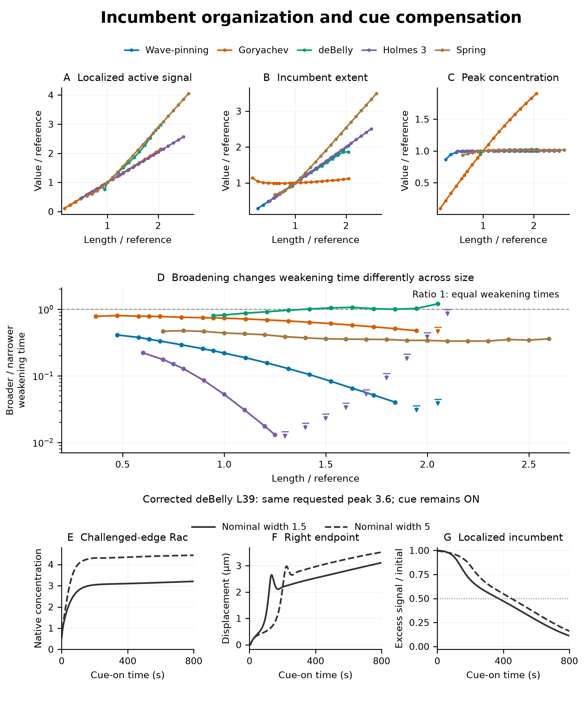

# Figure 2: current experimental review candidate

[Main 7.2-inch print plate](../compensation_print_candidate_20261019/supporting/vectors/figure2_print_candidate.pdf) · [Main PNG](../compensation_print_candidate_20261019/figure2_print_candidate.png) · [376-word caption](../compensation_print_candidate_20261019/CAPTION.md).

The three starting-state panels retain the prior all-five incumbent organization. The new response panel measures how broadening changes the time to weaken localized incumbent activity across the qualified length series. The native deBelly row then separates local activation, coupled endpoint response and incumbent loss. It illustrates a coupled model response without isolating a causal share of the timing difference.

The expanded study contains **3492 core protocols across all five linear models and all 97 qualified basals, plus two targeted deBelly withdrawals: 3494 logical protocols**. The core design tests three baseline widths, five middle-width peak factors and five model-specific pulse durations, with 10000 native cue-free units after withdrawal and 97 no-cue controls. Width and strength arms form an efficient staged design, not a full width × strength factorial. No duration monotonicity or optimized minimum is assumed.

- [Complete five-page campaign PDF](supplement/supporting/vectors/complete_five_model_compensation.pdf), with every tested length, width/strength/pulse outcome and retained native field-tail flag.
- [Full deBelly L39 native course](../debelly_width_timecourse_card_20261019/supporting/vectors/debelly_L39_width_card.pdf) and [L18 contrast](../debelly_width_timecourse_card_20261019/supporting/vectors/debelly_L18_width_support.pdf), preserving 2000 cue-ON plus 10000 cue-free seconds.
- [Selection, no-cue controls and two targeted T500 outcomes](selection/README.md). Both T500 cases return despite different weakening latencies; neither establishes a width-specific retained fate.
- [Main reconstruction closure](../compensation_print_candidate_20261019/supporting/metadata/redraw_closure.json), [native-card closure](../debelly_width_timecourse_card_20261019/supporting/metadata/redraw_closure.json) and [full-study supplement closure](supplement/supporting/metadata/redraw_closure.json). Redrawing these figures uses compact CSV inputs and no native NPZ archives.
- [Baseline actual-results report](baseline/README.md), [strength report](strength/README.md), [background/core sensitivity](excess/README.md) and [strength sensitivity](strength_excess/README.md).

Native and derived numerical evidence has independent audits. The main print plate and native card have passed independent reconstruction, data and display checks; the comprehensive supplement's final display audit is recorded separately. Presentation remains a review candidate, and all earlier artwork is preserved.
