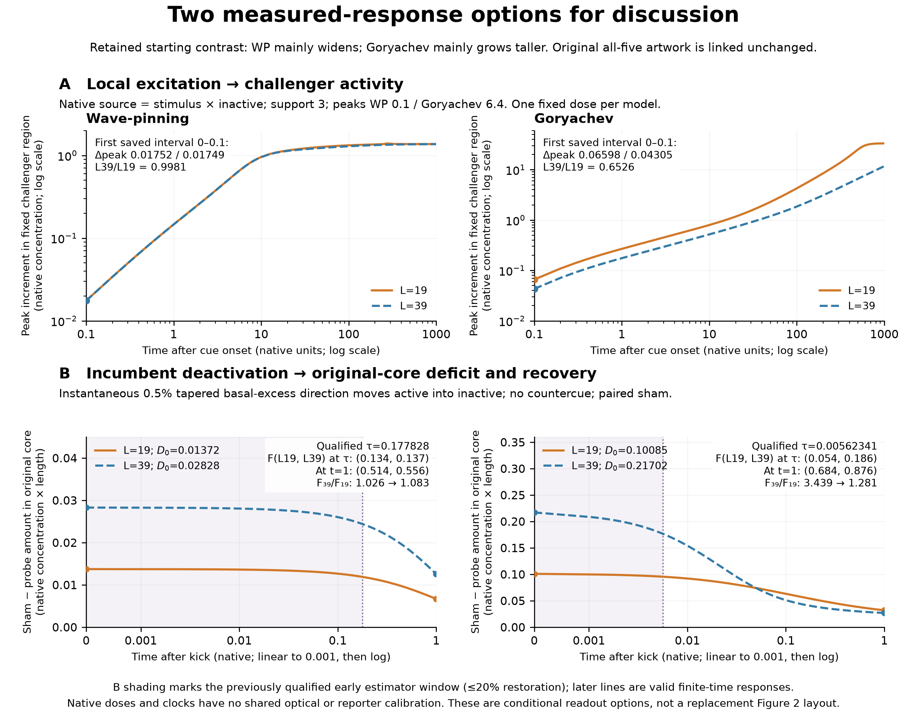

# Native finite-response options for author discussion

This is a small evidence/readout discussion sheet, not a replacement Figure 2 or an optical-actuator choice. The reviewed prototype, earlier options note and all original artwork remain unchanged. The central question remains whether similar reversal-size trends arise through mechanisms predicting different challenge responses.

## Retained organization: unchanged original evidence

[Original all-five organization figure](<../../../../../../../../../current manuscript figs/initial_polarity_length.png>). Its exact 97 basal measurements distinguish broader poles from the taller Goryachev peak. Over L19→39, WP amount/width/peak folds are 2.124/2.042/1.000; Goryachev folds are 2.152/1.119/1.903. This passive comparison motivates the conditional challenges below; it does not by itself establish a reversal mechanism.

## Two finite-response options

[PDF](supporting/vectors/finite_response_options.pdf) · [SVG](supporting/vectors/finite_response_options.svg) · [Caption](supporting/metadata/CAPTION.md)

**Excitation:** taller, substrate-depleting organization → a local native coefficient multiplying inactive material → weaker measured challenger activity. Both highlighted models add stimulus×inactive to active and subtract it from inactive. A GEF-recruitment actuator, direct activity forcing and inhibition have not been shown to implement the same channel. Inactive-independent forcing would lack this instantaneous substrate factor. The curves are actual saved field changes, including all native reaction and transport, not the calculated input gain.

**Deactivation:** different organization/coupled kinetics → a declared local active-to-inactive loss → different evolution of the original-core activity deficit relative to a paired sham. The graph uses actual amounts and their absolute initial deficits D₀. It does not plot an instantaneous reaction derivative. This controlled recovery cannot isolate feedback from transport or uniquely allocate reversal resistance.

## What survives a wider observation window?

The activation contrast is not confined to t=0.1: over all saved points from 0.1 to 10, the L39/L19 peak-increment ratio is 0.99718–0.99808 in WP and 0.65089–0.65325 in Goryachev. Across the entire 1000-unit cue it remains below 1: 0.96652–0.99808 versus 0.25344–0.65325. The late nonlinear response therefore preserves the direction of the contrast, not a fixed fold. The first post-cue sample is 0.1; the interval 0–0.1 is measured only by its two endpoints. There is no matched excitation-amplitude sensitivity in this selected fixed-support set; computed gain cannot fill that gap.

The recovery contrast also persists through the complete stored 1-unit follow-up, but its fold weakens:

| Model | Qualified early clock | F at that clock, L19 / L39 | F at t=0.1, L19 / L39 | F at t=1, L19 / L39 |
| --- | ---: | ---: | ---: | ---: |
| WP |0.177828|0.1339 /0.1373|0.07831 /0.07981|0.5136 /0.5563|
| Goryachev |0.00562341|0.05404 /0.1859|0.3749 /0.7648|0.6844 /0.8764|

Goryachev's F₃₉/F₁₉ fold drops 3.439→2.040→1.281 over its qualified clock→0.1→1. WP's fold is 1.026 at its clock and 1.083 at 1. In native amount units the initially larger Goryachev deficit crosses below the smaller-cell deficit between the saved times 0.047315 and 0.050119. This is an observed crossover bracket, without interpolation.

The 0.1%, 0.5%, 1% kick sensitivities retain amplitude linearity through 1 for all four cases. Their maximum absolute spread in F over 10⁻⁴–1 is 0.00165 in WP and 0.00302 in Goryachev. Later restoration exceeds the 20% qualification gate for the early estimator; that does not invalidate the later native trajectories. The qualified clocks were the largest common tested pilot windows satisfying numerical/linearity/early-restoration gates, not experimentally chosen sampling times.

## Experimental inference remains conditional

These are finite-time model signatures with documented wider-window persistence, rather than only instantaneous algebraic diagnostics. They are not yet validated optical protocols. The primary deactivation removes only 0.217–0.223% of WP core activity and 0.285% of Goryachev core activity: no reporter precision or response time has been established to resolve those changes. Native time has no shared experimental calibration; a slow reporter or actuator could average away the earliest contrast. The deactivation is an instantaneous state kick, not a simulated finite optical pulse. Goryachev L39 has four native sample centres in its original core; the prior checks do not establish spatial convergence. There is no active-loss follow-up beyond 1 in these archives. Zero-kick and tighter-solver comparisons qualify the saved numerical response, not experimental measurability.

Thus the useful discussion choice is which characterized perturbation and reporter could test the distinct conditional responses. The present data support that question; they do not select the actuator or prove a unique molecular explanation.

[All native excitation reads](supporting/data/activation_cue_curves.csv) · [All paired sham/probe amount traces and three amplitudes](supporting/data/recovery_native_curves.csv) · [Window comparisons](supporting/data/recovery_window_contrasts.csv) · [Amplitude sensitivity](supporting/data/recovery_amplitude_sensitivity.csv) · [Sources, checks and missing flags](supporting/metadata/validation.json)
