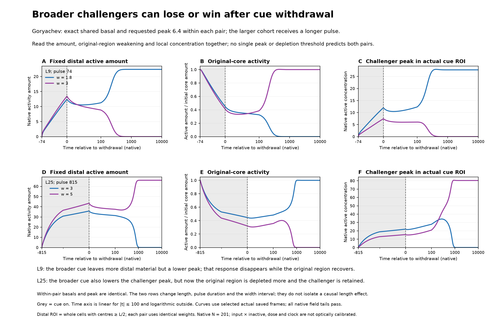

# Paired native width histories: Figure 2 option

[One-sheet PDF](supporting/vectors/figure2_paired_width_timecourses.pdf) · [Native plotted samples](supporting/data/paired_native_curves.csv) · [Withdrawal/final values and source flags](supporting/data/paired_native_endpoints.csv)

The same increased width can accompany more distal active material and a lower local peak in both cohorts, but the retention direction differs. At L9 the broader response disappears; at L25 it persists. This illustrates why incumbent weakening and challenger maintenance need to be examined together. The larger native incumbent is part of the context, not an experimentally isolated explanation of these two width contrasts: the pulse and width interval also differ.

The exact basal and requested peak 6.4 are shared within each pair. The distal region uses whole native cells whose centres satisfy $x_i \ge L/2$; the same cell weights are applied to both widths at that length. Original-core activity is normalized to its exact common initial amount, without independent curve scaling. Peaks are native active concentration in the actual physical cue ROI. Native stimulus times inactive recruits activity locally while nonlinear maintenance and transport continue. Broadening also changes integrated input.

Source fields were saved every 0.1 cue-on unit and every 0.25 cue-free unit through 10000 after withdrawal. Plotted samples use 0.5 cue-on units, 0.25 off units through 100, 2.5 through 1000 and 10 thereafter, including exact endpoints. These are finite histories, not minimum-pulse measurements. All four original scalar-strength and native field-tail flags are retained separately in the endpoint table. The original all-five amount/width/peak organization panel and validated coupled vignette remain unchanged. The [native state-law note](../coupled_state_law_20261019/README.md) provides bounded mechanistic context without assigning the final outcome a unique cause.
