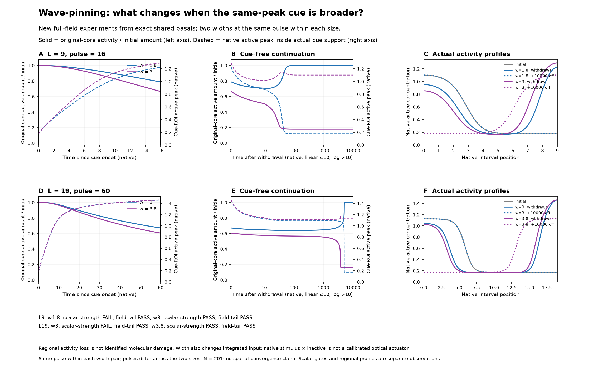
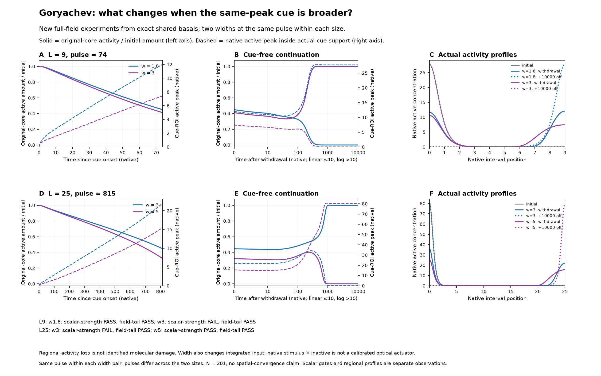

# Fixed-pulse cue-width experiments: actual native-field review

[Current review PDF](supporting/vectors/figure2_width_fullfield_review.pdf)

These are new full-field measurements from eight selected fixed-pulse protocols, not a finished Figure 2. Only completed pairs are shown. The original all-five incumbent organization remains the foundation: [unchanged prior organization](../finite_response_candidate_20261019/figure2_organization.png).

In WP, the broader cue leaves less activity in the original core at withdrawal: 0.789→0.665 of its initial amount at L9 and 0.671→0.605 at L19. Both broader cues end with retained right polarity; both narrower cues return to the incumbent. The L19 challenger peaks at withdrawal are almost identical (1.4599/1.4615), despite the different eventual outcomes.

In Goryachev, broadening lowers the withdrawal challenger peak at both sizes (12.025→7.433 at L9; 22.014→15.519 at L25) and also lowers original-core activity (0.449→0.412; 0.446→0.320). The narrower cue wins at L9, whereas the broader cue wins at L25. Thus neither withdrawal challenger height nor incumbent-region depletion alone explains all four fates. The cue-free histories show the subsequent growth/return directly. These are conditional native-model observations, not a unique mechanism identification.

Pulses match within each width pair but differ between size cohorts. The separately frozen next stage crosses physical width, native peak and pulse duration independently, using the same pulse grid at both sizes within each model; it is explicitly a two-model stage.

[Exact numerical summary](supporting/data/actual_fullfield_summary.csv) · [Methods and limits](EVIDENCE.md) · [Source hashes](supporting/metadata/validation.json)
