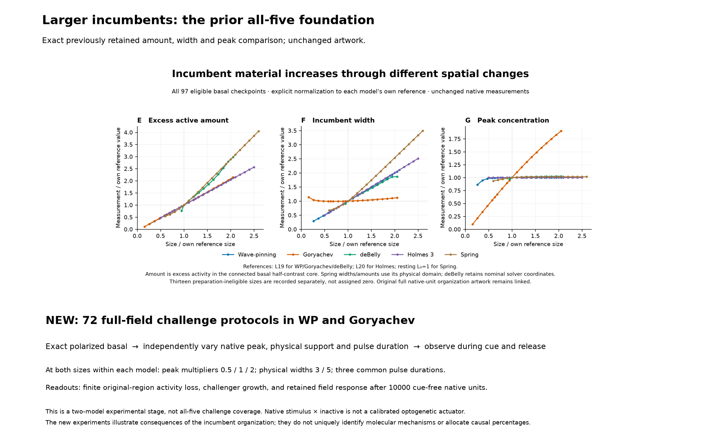
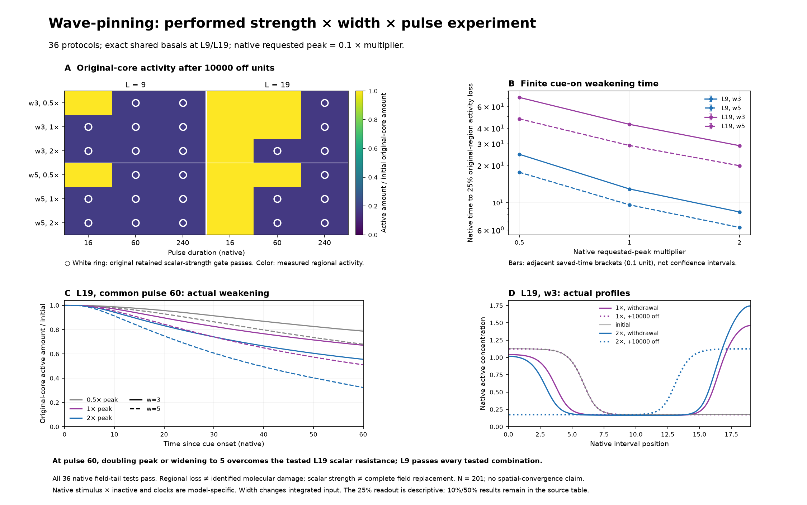
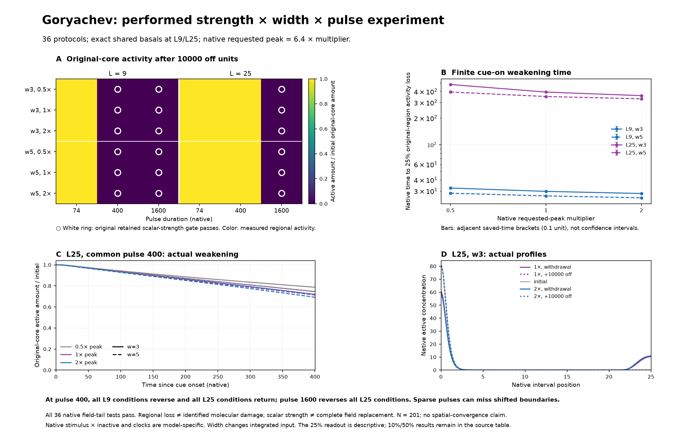

# Performed cue experiments: fresh-read guide

[Three-page review PDF](supporting/vectors/figure2_performed_cue_grid_review.pdf)

Page 1 preserves the exact prior all-five organization artwork as the foundation. Pages 2–3 report the new 72-protocol two-model experiment: actual retained original-region activity, finite weakening times and native fields. These are reviewable results, not an accepted final Figure2 composition.

{width="687"}

A uses measured activity in a fixed initial spatial core, divided by that core’s initial amount. Rings identify the original retained scalar-strength gate separately. B uses the longest common pulse in each model to observe the first sampled 25% regional-depletion transition; bars are adjacent 0.1-unit saved brackets. C holds pulse fixed at the intermediate duration and shows all six peak/width combinations in the larger cohort. D displays actual native profiles for the baseline and doubled peak at fixed width 3.

A separate direct full-field check compares each final active/inactive state with its exact basal and with the spatial reflection of that basal. All 72 are within 5.282e-08 of one template when each native species is divided by its inherited fixed scale, and the closer template agrees with the scalar outcome. This is a direct native-field comparison at 10000 cue-free units, not a deduction from the scalar gate or proof of asymptotic replacement. [All 72 template comparisons](supporting/data/native_endpoint_template_matches.csv).

[Result-specific interpretation and robustness](RESULTS.md) · [Caption and measurement definitions](CAPTION.md) · [Complete native readouts and limits](README.md) · [Eight initial full-field width contrasts](../width_fullfield_experiment_20261019/README.md)
