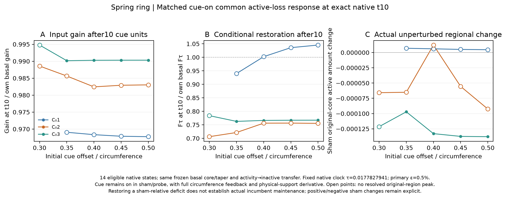

# Spring ring challenged-state common response

The 14 eligible 1000-unit native branches supply exact saved states at cue time10. The opposing physical-support0.2 cue (peak4, fixed material centre) remains ON in both sham and probe. Its circumference derivative enters the analytic Jacobian as C evolves. No state interpolation is used.

The conservative activity-loss perturbation uses each size's original basal half-contrast material core and cosine-tapered basal excess direction, with epsilon0.001/0.005/0.01. Initial circumference is unchanged; all native chemical and circumference states evolve. This is the same active-loss assay as the chemical-ring t10 counterpart, not the older inactive-withdrawal coefficient.

The table preserves every empirical numerical, prefix-saturation and amplitude-linearity gate, plus initial/current cue overlap, actual sham/probe changes and availability of an original-region-associated resolved peak. Where no such peak is resolved, the coefficient is explicitly a regional conditional response. Peak presence concerns fixed geography and does not establish site ancestry. Positive deficit restoration is not actual original-region maintenance under the challenger.

The fixed native clock is0.01778279410038923. Basal and challenged fractions are compared only within the same resting size. The single excluded C01,f0.30 preparation geometry remains explicit. Native units and the mean-force/stretch/dilution/diffusion ring analogue remain distinct from the interval model and from cell movement.

[Complete measurements](supporting/data/spring_challenged_t10_recovery.csv) · [Gain and geometry](supporting/data/spring_challenged_t10_gain_geometry.csv) · [Unavailable condition](supporting/data/unavailable_original_conditions.csv) · [Numerical verification](supporting/metadata/verification.json)
