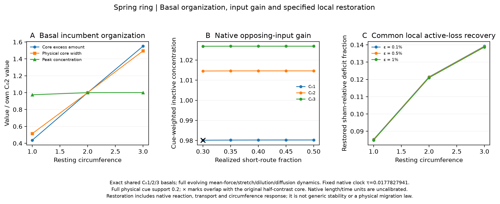

# Spring ring basal organization and response

Generated 2026-10-19T15:03:54.936931+00:00; all producers finished. No timed refresh.

The exact shared C₀1/2/3 basals qualify. Native inactive concentration is the additive activation gain. A conservative local active-loss perturbation measures sham-relative deficit restoration while the full coupled chemical/circumference state evolves. This ring analogue retains the explicitly accepted mean-force/stretch/dilution/diffusion closure and does not replace the native interval model.

| Resting C₀ | Actual C | Core width | Core excess | Peak | Fτ (0.5%) | Kτ | Qualified |
|---:|---:|---:|---:|---:|---:|---:|---|
| 1 | 1.0414031 | 0.49650378 | 0.18976477 | 1.1759987 | 0.085078253 | 4.7843017 | True |
| 2 | 2.0441807 | 0.96449609 | 0.43462219 | 1.2063044 | 0.1212074 | 6.8159928 | True |
| 3 | 3.0451683 | 1.4420156 | 0.67385718 | 1.2073767 | 0.13896215 | 7.8144161 | True |

The original periodic half-contrast core has interpolated boundaries and fractional finite-volume edge weights. A smooth cosine taper of its basal excess is reduced by 0.1%, 0.5% or 1%; the same material enters inactive at each cell and initial circumference is unchanged. Sham and probe both evolve all native fields. Core weights remain fixed in material coordinates, and each trajectory's own physical circumference enters every amount.

\[D(t)=A_{\mathrm{sham}}(t)-A_{\mathrm{probe}}(t),\qquad F_{\tau}=\frac{D(0)-D(\tau)}{D(0)},\qquad K_{\tau}=\frac{F_{\tau}}{\tau}.\tag{1}\]

The fixed clock is τ=0.01778279410038923 native units. Paired BDF histories use an analytic Jacobian and two numerical tolerances. Zero-kick identity, pointwise conservative transfer, physical amount conservation, prefix empirical numerical sensitivity ≤10⁻⁵, ≤20% restoration, and 5% amplitude linearity plus numerical allowance are checked. All three cases pass. Every complete history and gate remains in supporting/data and supporting/metadata/verification.json.

Gain uses a raised cosine spanning 0.2 native physical units at the same native cell positions as competition, requested offsets 0.30/0.35/0.40/0.45/0.50 of circumference. An additional 101 requested offsets cover 0–0.5. The tables retain requested and realized position, physical separation, normal angle and overlap. C₀1 at fraction 0.30 overlaps the original core and is excluded from eligible competition. A larger local restoring response does not establish greater actual retention under a challenger, and a fixed physical site displacement has different angular meaning at different circumferences.

No challenged-state recovery campaign, duration optimization, generic-stability inference or velocity law is introduced. See [recovery](supporting/data/spring_basal_recovery.csv), [gain](supporting/data/spring_basal_gain.csv), [organization](supporting/data/spring_basal_organization.csv), [native profiles](supporting/data/spring_native_basal_profiles.csv) and [numerical verification](supporting/metadata/verification.json).
