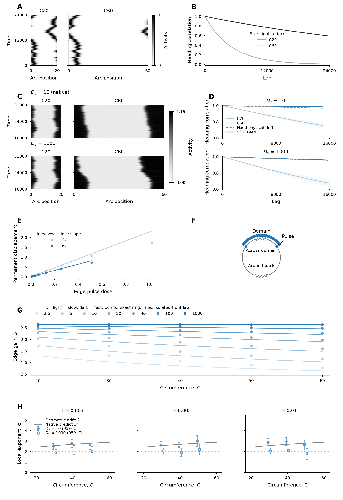

# Figure R1

[PDF](figureR1_main.pdf) · [SVG](figureR1_main.svg) ·
[Legend](supporting/metadata/main_legend.md) ·
[Scientific readme](supporting/metadata/scientific_readme.md) ·
[Compact plotted data](supporting/data/) ·
[Provenance](supporting/metadata/provenance.json)

The fast-cytosol campaign contains 5,760 matched-noise histories and 16 native
solver checks. All records completed and passed compact-integrity checks.
The readme reports the slow-diffusion conduction-law discrepancies and the
small native solver difference; no parameter was retuned.

[R1/R2 rebuild commands and status](../README.md)
