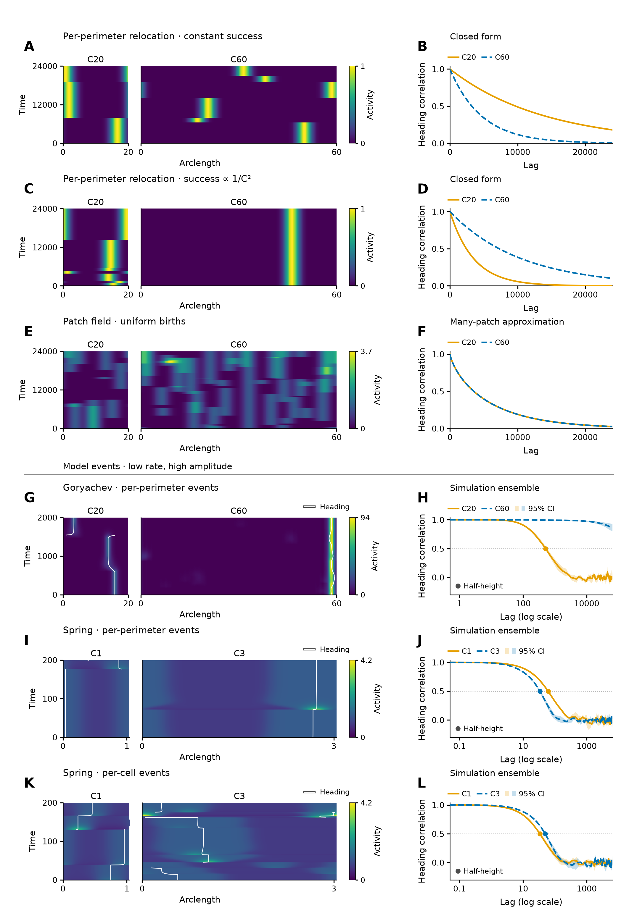

# Unexpected

- The requested inverse-square-success relocation was absent from the round-7 package. The existing R2 fixed-seed path is reused; the constant-success paths come directly from round 7. No relocation example was searched or redrawn.
- The patch-field correlation is the many-patch approximation, with only 3.33 mean live patches at C20. A finite sample may contain no live patches and have no heading. The analytic curve is not fitted to the sample path.
- Goryachev's current size exponent remains a lower bound (α ≥ 5.1654), because C60 has no mode-1 half-height crossing at the maximum record. Its previous R2 summary predated the last completed extension.
- Spring per-cell retained only modes 0/1. Exactly one original seed per size was replayed for full profiles, preserving all dynamics and event sequences. All shared event entries and native-cadence headings agree exactly; circumference differs by less than 4.45 × 10⁻¹⁶. These display replays do not enter persistence estimation.
- Spring's three-size per-cell exponent shares the original size-2 trajectory with its circumference-dependent hazard. The two displayed outer sizes have constant per-cell intensity.

# Figure R2



[PDF](figureR2_main.pdf) · [SVG](figureR2_main.svg) · [Legend](supporting/metadata/main_legend.md) · [Review log](supporting/metadata/review_log.md)

Six cases, each with a paired-size activity kymograph and matching heading correlation. A–F are null processes; G–L are the three requested event-model cases. The former exponent panels, event-triggered analysis, regenerated event logs and drift guide are deleted from this figure package; no supplement was created. Original campaign evidence remains read only.

The rebuilt figure uses the requested low-rate/high-amplitude conditions, native axes, orange/blue size hues, physical-width kymographs, perceptual colour scales and shared scales within models. Source windows were fixed before viewing headings: the first 40 event decay times after burn (2,000 Goryachev; 200 Spring), fixed replicate 0, with 801 uniformly spaced output times. Null windows preserve the original 24,000-unit duration and interval 20. There was no seed search, window search or parameter retuning. Biological migration measurements, conditional OU velocity persistence and simulated activity-heading persistence remain distinct readouts.

Visual review stopped at the requested five-round cap (10 fresh-context reviews). The outside reader recovered all six comparisons; remaining editor notes concern the immediacy of Spring's modest shift and small print keys. The [review log](supporting/metadata/review_log.md) records findings, fixes and the stop criterion.

## Compact data and provenance

The 12 `*_profile.csv.gz` files are wide tables with `time`, `circumference`, and signed `activity_000`, … at display-grid cell centres. Physical arclength of column j in a row is (j + 1/2) times that row's circumference divided by the number of activity columns. The relocation and patch grids contain 240 positions; the regenerated Spring records retain all 100 or 300 native cells. All clipping occurs only in the display.

`half_height_markers.csv` records the intersections of the displayed heading curves with correlation 0.5 (interpolating the displayed segments in log lag), solely as visual guides. `profile_heading.csv` contains the model-kymograph heading trace positions, coherences and plotting masks. `null_heading.csv` contains both analytic size curves in each null. `model_heading.csv` contains the plotted ensemble means, pointwise intervals, coverage and pair counts. `model_heading_seed_moments.csv.gz` preserves four-seed sufficient statistics. `model_rates.csv`, `model_alpha.csv`, `model_alpha_bootstrap.csv.gz` and `model_records.csv` preserve the selected rate/exponent calculation and exact condition/seed/record information needed for the legend. No excluded condition is used to choose an example.

[Profile source receipt](supporting/metadata/profile_sources.json), [null source receipt](supporting/metadata/null_sources.json), [statistics source receipt](supporting/metadata/display_statistics.json), [statistics validation](supporting/metadata/statistics_validation.json), and [render hashes/time](supporting/metadata/render.json) document the completed producers and data-generation times. The full-profile replay uses SLURM array 21412176 (red/small, one CPU, 2 GB per task); statistics extraction used job 21412185 (red/small, one CPU, 8 GB).

## Separate mode-1 analysis

**Separate mode-1 analysis; these are not fits to H, J or L.** The unchanged campaign exponent α is the negative three-size log-rate/log-mean-circumference slope, using first mode-1 half-height crossings:

| Model / supply | α | 95% whole-seed interval |
| --- | ---: | --- |
| Goryachev / per-perimeter | ≥ 5.1654 | Lower endpoint 5.0579; upper unbounded |
| Spring / per-perimeter | −0.2389 | [−0.3038, −0.1788] |
| Spring / per-cell | 0.8695 | [0.8396, 0.8945] |

Goryachev C60 remains censored. The per-cell exponent shares the original size-2 trajectory with its circumference-dependent hazard. The source receipts above document selection, replay checks and native conventions.

## Rebuild

From the repository root, with the existing environment:

```bash
conda run -n scaling_sandbox python -B polarity1d/manuscript/code/mechanisms/rebuild_figureR2_20261027.py render --round 6
```

Rendering reads only the portable CSVs. To re-extract profiles on this HPC checkout, use the same script's `extract` command. Recompute selected statistics under SLURM with `code/mechanisms/r2_display_statistics_20261029.py`; use red/small, one CPU, 8 GB. The completed, immutable display-only replay is under `data/runs/ring_r2_display_profiles_20261029/`; its helper `code/mechanisms/ring_r2_display_profiles_20261029.py` documents preparation, submission and validation. Do not overwrite frozen campaign or replay sources. Full local source arrays are not required for a portable render.
