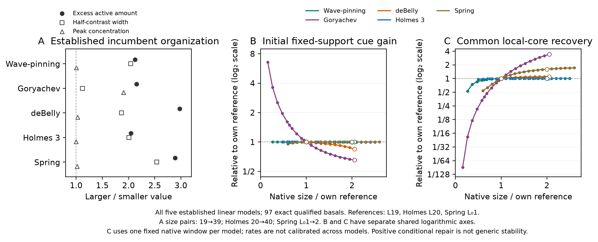
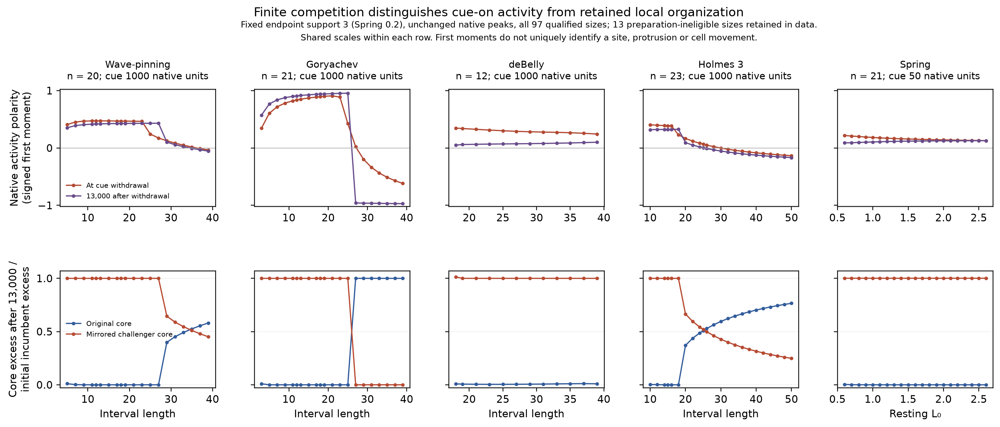

# All-five linear checkpoint evidence: organization, response and finite competition

**Message.** Enlargement increases incumbent material in every established model, while its consequences differ. The complete gain and common local-recovery series show strong size dependence in Goryachev and smaller or differently structured responses in the other models. A fixed local finite cue then exposes replacement, incumbent return and persistent two-region activity. These finite outcomes are displayed alongside the transient assays rather than inferred from them.

## Organization and local function across every qualified size

**Why this figure.** The accepted amount/width/peak comparison anchors the functional question. Every qualified size enters both response curves. Separate shared log₂ axes retain the full short-cell range and keep nearly unchanged responses near one; no model receives its own stretched scale. Open markers identify the exact organization size pairs. All values are linear; ring coefficients do not enter this figure.

| Model | Exact size pair | Initial gain fold | Common local-repair fold | Fixed recovery τ, native units |
|---|---|---:|---:|---:|
| Wave-pinning | 19 → 39 | 1 | 1.02562 | 0.17782794 |
| Goryachev | 19 → 39 | 0.653611 | 3.43942 | 0.0056234133 |
| deBelly | 19 → 39 | 0.845699 | 1.10175 | 5 |
| Holmes 3 | 20 → 40 | 0.999843 | 1.00871 | 0.17782794 |
| Spring | 1 → 2 | 1.00423 | 1.608 | 0.017782794 |

Initial gain is the extra primary-activity production per unit native activation input, averaged over the fixed endpoint cue. It is inactive substrate in WP/G/Spring, inactive Rac divided by 7.5 in Holmes, and 0.04/(1+Rho²) in deBelly. Native channels and clocks are not calibrated between models.

The common perturbation removes epsilon = 0.005 times a smooth, fixed basal-incumbent excess profile, with 0.001/0.01 amplitude checks. Explicit inactive pools receive that material where present; deBelly changes Rac alone while MCA/mechanics/controller states start unchanged. Every native field then evolves. Within the frozen original core,

\[
D(t)=A_{\mathrm{sham}}(t)-A_{\mathrm{probe}}(t),
\qquad K_{\tau}=\frac{D(0)-D(\tau)}{\tau D(0)}.
\tag{1}
\]

All 97 measurements qualify at their fixed model clocks under the reviewed empirical numerical, amplitude-linearity and unsaturated-prefix gates. Actual sham/probe changes and rates, core/whole/outside deficits and every gate remain in the [recovery summary](supporting/data/vision_linear_recovery_summary.csv) and [complete audit](../../../../data/runs/vision_linear_20261017/recovery/results/verification.json). The positive coefficient concerns this activity-loss direction, not general stability or resistance to an actual challenger. In deBelly it does not measure the difficulty of rewriting MCA/mechanical organization, which the kick leaves initially intact.

## Substantive finite competition and withdrawal

**Why this figure.** Native first moments give a bounded signed activity summary during and after a substantial cue. The second row shows the local regional amounts that a first moment can obscure: near-zero polarity can accompany two active regions. All five models and 97 qualified sizes remain visible. Each row has a common scale. The [full-range cue-on/core comparison](vision_linear_finite_competition.png) retains deBelly's large direct cue response.

The right-end cosine has fixed support 3 (Spring 0.2) and unchanged model-native peaks 0.1/6.4/3.6/1/4 for WP/G/deBelly/Holmes/Spring. Primary duration is 1000 native units, Spring 50, followed by 13,000 cue-free units. These are standardized within-model exposures, not universal commitment or physical-time calibration. The prior fixed-support reference strength clocks are 73.5, 377.5, 335.79, 2360 and 0.31014 respectively: even Holmes' reference does not need to commit within 1000. Half/double-duration checks at the prespecified 15 short/middle/long anchor states are retained; amplitudes and durations were fixed before inspecting the new histories.

| Model | Qualified sizes | 10,000 off: orientation / strength / field flag | 13,000 off: orientation / strength / field flag |
|---|---:|---|---|
| Wave-pinning | 20 | 16 / 14 / 19 | 16 / 14 / 19 |
| Goryachev | 21 | 14 / 14 / 21 | 14 / 14 / 21 |
| deBelly | 12 | 12 / 11 / 12 | 12 / 11 / 12 |
| Holmes 3 | 23 | 8 / 6 / 23 | 8 / 6 / 23 |
| Spring | 21 | 21 / 21 / 21 | 21 / 21 / 21 |

The new full native histories reproduce every existing primary 10,000-unit scalar and field flag. Continuing to 13,000 leaves those counts unchanged, while the earlier 3000-unit window can differ: deBelly has 12 orientation, 5 strength and 0 field passes then, compared with 12/11/12 at 8000–13,000. A rightward scalar bias is therefore distinct from original strength and full-field stationarity. These finite-window flags do not prove attractors.

At the largest intervals, WP L39 and Holmes L50 can retain two threshold-defined active regions after withdrawal; Goryachev L39 instead restores its original incumbent despite challenger activity during the cue. All deBelly/Spring primary cases end right-oriented. deBelly L18's mirrored-core excess is about 7.99 initial-incumbent units during the cue and 1.013 after withdrawal. Its nonconserved Rac source and slower native fields make cue-on amplitude a different observation from retained organization. The complete nonmonotone/null size responses and unreached crossing clocks are preserved in the [finite table](supporting/data/vision_linear_finite_metrics.csv), [declared time samples](supporting/data/vision_linear_finite_samples.csv) and [finite report](supporting/metadata/FINITE_RESULTS.md).

## Measurements motivated by these results

| Theoretical observation | Corresponding measurement question |
|---|---|
| Incumbent material grows through different peak/width changes. | How do reporter peak, active-region extent and integrated signal change with cell size? Molecular amount requires calibration. |
| Equal native local input can produce different early activation. | Under a fixed measured local stimulus, how fast does a competing activity region initially grow? |
| A specified local activity deficit can recover without rewriting all slower fields. | After brief local suppression, measure local loss/rebound alongside the incumbent's other organizational features. |
| Cue-on competition and post-cue survival differ; two regions can cancel a global bias. | Track incumbent/challenger activity, extinction/merger or coexistence, and global activity-polarity magnitude/direction during and after a finite cue. |

WGD-associated enlarged-cell persistence motivates these measurements. Neither a first moment nor a local recovery coefficient is a cell velocity law, and these simulations do not establish that size alone causes the migration observations.

## Evidence, numerical scope and completion

The [supplied mechanism PDF](../../length_mechanisms.pdf) already establishes incumbent enlargement and selected finite collapse/retained-reversal examples. The previous canonical duration suite, identified in the [long-cue inventory](supporting/metadata/LONG_CUE_INVENTORY.md), already contains the primary scalar branches used here. This campaign adds the complete common active-loss recovery series, independently audited fixed-exposure native histories/regions and 13,000-unit comparison. It does not claim every finite fate as a new discovery or import ring results into linear evidence.

All 97 qualified exact checkpoints are retained, plus 13 preparation-ineligible rows in finite coverage. C reuses 15 exact reviewed pilot archives and adds 82 missing cases. Every main measurement uses its completed original full-span archive. The slow Spring L₀0.8 original finished before any substitution or cancellation; its later candidates are measured. A separately frozen, root-authorized early-window run at L₀0.8 and its adjacent L₀0.9 validated the effect of changing the adaptive solver's final time. It passes the unchanged sensitivity allowance and remains additional validation, unused by the main collection. Only that separate run has unmeasured later candidates. See the [amendment definition](supporting/metadata/EARLY_WINDOW_AMENDMENT.md), [fresh audit and original-versus-amendment comparisons](supporting/metadata/EARLY_WINDOW_REVIEW.md) and [amendment results](../../../../data/runs/vision_linear_20261017/recovery/early_window_amendment/results/verification.json).

Goryachev L39's original core has four native cell centers; native solver/reference checks do not establish spatial convergence. Core membership/background stay frozen, raw and signed excess are separate, and outside-core transport is not relabelled whole-activity restoration. Spring uses each evolving physical length; deBelly keeps independent endpoints, native 0.5-unit stepping and all 11 fields/controllers. Native full state is continuous at withdrawal; cue-dependent derived rates can jump appropriately.

- [Design and approved protocol](DESIGN.md), [fresh design review](supporting/metadata/DESIGN_REVIEW.md), and [original long-cue inventory](supporting/metadata/LONG_CUE_INVENTORY.md).
- [Recovery inputs/producer](../../../../data/runs/vision_linear_20261017/recovery/manifest.json), [all recovery curves/gates](../../../../data/runs/vision_linear_20261017/recovery/results/), and [finite inputs/producer](../../../../data/runs/vision_linear_20261017/finite/manifest.json).
- [Finite archive and scalar audit](../../../../data/runs/vision_linear_20261017/finite/results/verification.json); every one of the 97 primary and 30 anchor branches is complete, with 13 unavailable preparations visible.
- [Compact normalized functional table](supporting/data/vision_linear_normalized_function.csv) and [gain source](supporting/data/vision_linear_gain_all97.csv). PNG figures have PDF/SVG counterparts under supporting/vectors.

The [fresh actual-result critique](supporting/metadata/FRESH_RESULT_CRITIQUE.md) is the independent review of these actual outputs. This evidence is supplied to the checkpoint assembler; no further size/duration search is launched by report generation.
