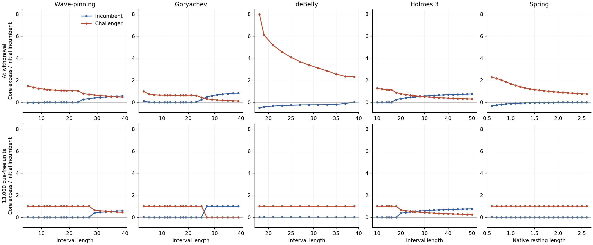

# Fixed local-cue competition in all five established linear models

Generated 2026-10-17T20:24:39.591274+00:00; producer finished. These development results keep interval and ring evidence separate. No movement law is assumed.

The same model-specific peak and physical support are applied across every retained size. The primary pulse lasts 1000 native units (Spring 50), followed by 13,000 cue-free units. The top row shows activity at withdrawal; the bottom row shows what remains after withdrawal. Signed excess in fixed basal cores is normalized by initial incumbent excess; raw integrals, peaks, complete native fields and all unavailable crossing clocks are retained separately. **All ten panels use one shared y-range computed from every plotted value.** Negative excess is displayed without clipping and denotes activity below the starting background, not negative concentration. These local-region amounts are not unique-site or migration classifications.

The finite exposure yields distinct size-dependent outcomes. At the longest retained size, Wave-pinning and Holmes retain two connected regions above the initial half-contrast threshold after withdrawal. Their incumbent/challenger core-excess ratios are respectively 0.581/0.451 at L39 and 0.766/0.248 at L50 after 13,000 cue-free units. Goryachev L39 returns to the incumbent (ratios approximately 1/0), although its challenger is activated during the cue. In contrast, every retained deBelly and Spring primary branch passes the original right-orientation gate. These examples follow the prespecified longest eligible size in each model; they do not establish a universal size response.

Cue-driven activity and its later survival differ substantially. For deBelly L18, challenger core excess is 7.99 times initial incumbent excess at withdrawal, then approximately 1.013 after 13,000 cue-free units. Across deBelly's twelve primary branches, all twelve pass the orientation gate by the 3000-unit final window, but only five pass scalar strength and none passes the separate field-tail diagnostic then. At 8000–13,000 the counts are twelve, eleven and twelve. The short and long observation windows therefore support different convergence statements even when direction agrees.

|Model|Eligible|10,000 orientation|10,000 strength|13,000 orientation|13,000 strength|
|---|---:|---:|---:|---:|---:|
|wave_pinning|20|16|14|16|14|
|goryachev|21|14|14|14|14|
|debelly|12|12|11|12|11|
|holmes_model3|23|8|6|8|6|
|spring|21|21|21|21|21|

The independent old 10,000-unit scalar outcomes supply fixed expectations for all 97 primary branches. The new histories reproduce all three original flags, including the field-tail diagnostic. A scalar strength pass does not establish whole-field convergence. The long finite exposure is matched by input geometry, not by producing a desired fate; Holmes' reference strength clock exceeds 1000 and larger-size failures remain visible. Full nonmonotone size responses belong in the interpretation.

The 30 anchor sensitivities retain the same complete states and vary duration only. Shortest and middle Wave-pinning/Goryachev anchors pass at 500/1000/2000 while their longest anchors fail the orientation gate at all three durations. Holmes L28/L50 retain two above-threshold regions and fail both scalar gates across those durations. deBelly L18/L39 fail orientation at 500 but pass at 1000/2000, so the primary finite response depends on exposure. All three Spring anchors pass both gates at 25/50/100 native units. These bounded checks are not a search for an asymptotic or universal withdrawal threshold.

Experimental counterparts are local reporter amounts, peak intensities, spatial extent, challenger onset and incumbent loss/rebound, measured during a fixed local stimulus and after its removal. These measurements motivate polarity mechanisms; no cell velocity or migration persistence is inferred from the first moment.

All 97 qualifying basals and 13 unavailable preparations are retained in [metrics.csv](../../../../../../data/runs/vision_linear_20261017/finite/results/metrics.csv). [Declared samples](../../../../../../data/runs/vision_linear_20261017/finite/results/samples.csv) include cue-on fractions, exact withdrawal and postcue 3000/8000/10,000/13,000. [Verification](../../../../../../data/runs/vision_linear_20261017/finite/results/verification.json) reconstructs every regional value, gate and native phase boundary from archived fields. [Protocol and frozen sources](../../../../../../data/runs/vision_linear_20261017/finite/manifest.json) identify the complete execution closure. Fixed-support/core overlap is flagged, particularly Goryachev L3. Spring core membership uses its initial material coordinate while integrals use its own evolving physical length. deBelly uses the corrected independent endpoints; spatial integrals remain in nominal native coordinates.
