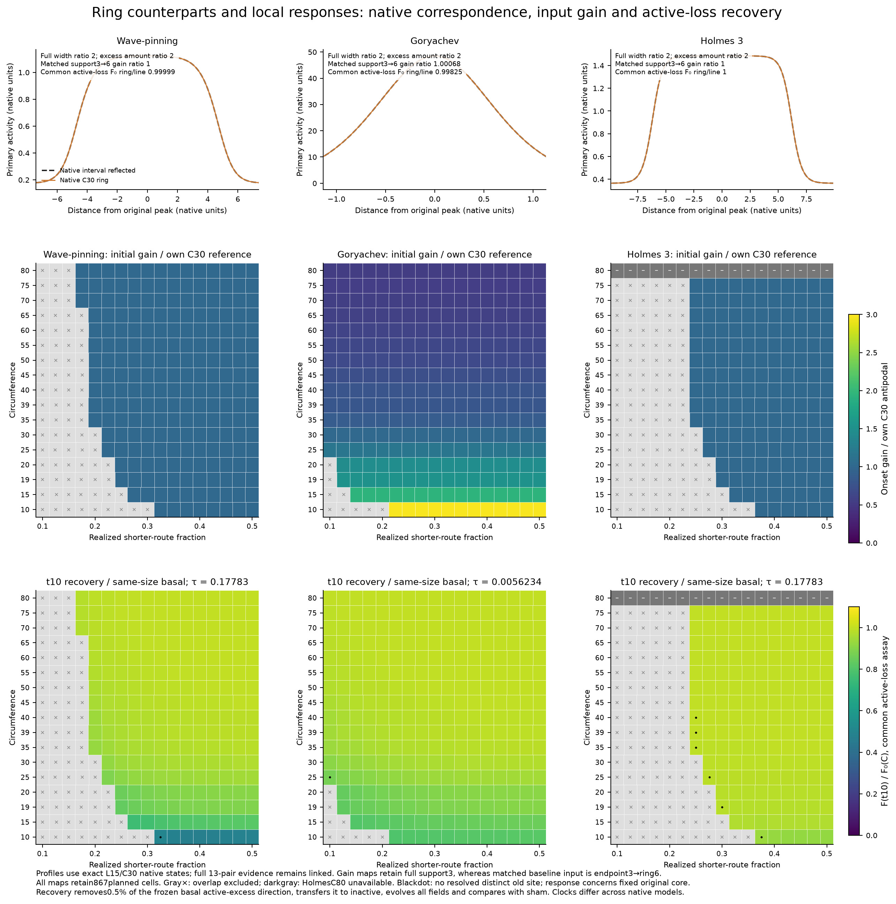
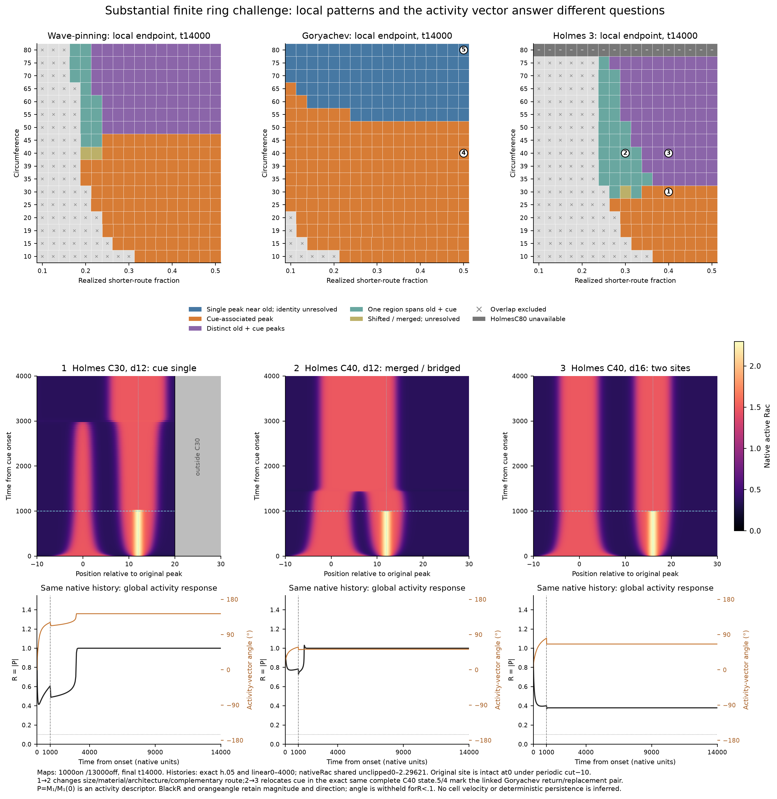

# Supported rings: local response, finite competition and global activity

Generated 2026-10-17T20:31:22.682989+00:00; all retained-data producers and the new ring recovery/duration campaigns are complete. This is one supported-ring evidence package for the three-figure checkpoint, not a new main-text variant. It follows [MANUSCRIPT_VISION.md](../../../../../../MANUSCRIPT_VISION.md) and keeps noisy persistence experiments separate.

The ring counterparts preserve native interval organization and function at C=2L, while finite competition depends on both size and cue position. The new conditional active-loss response is weakened by a challenge relative to each exact same-size basal control, yet remains positive while every early unperturbed fixed core loses active material. The substantial 1000-unit cue then produces cue-associated single peaks, merged regions or distinct sites. Those local patterns and the global activity vector provide complementary readouts; neither scalar recovery nor vector angle alone determines site fate or cell movement.



The upper native overlays use exact L15/C30 states, with native mesh samples and local display windows. Full ring width and excess-active core amount are twice the interval values; the same Figure 1B cue-weighted derivative uses endpoint support 3 versus reflected ring full support 6. The actual ring maps retain full support 3. All 13 matching native pairs and source hashes remain in the [baseline data](../expanded_ring_components_20261017/supporting/data/expanded_ring_baseline_pair_measurements.csv). The new common active-loss 13-pair comparison, at the identical native clocks, also agrees closely:

| Model | Native C=2L pairs | Maximum relative K difference |
| --- | --- | --- |
| Wave-pinning | 4 | 0.047667% |
| Goryachev | 4 | 1.0164% |
| Holmes 3 | 5 | 0.00022514% |

These are independently prepared states and unmatched native meshes. Goryachev's largest difference occurs at L35/C70 and exceeds its paired numerical error; the agreement is not exact identity, a grid-convergence result or a biological calibration of circumference. The [new same-assay pair audit](../../../../data/runs/vision_ring_recovery_20261017/results/ring_linear_common_recovery_pairs_audit.json) is distinct from the exact mirrored-operator fixture.

The gain maps retain all 867 planned cells and one shared 0–3 scale after each model's own C30 antipodal normalization. Distance dependence is nearly null: the largest within-size range is 0.0392% WP, 0.0891% Goryachev and 0.00208% Holmes. The recovery row uses only the new common active-deactivation assay, displayed as F₁₀(C, d)/F₀(C) on a shared 0–1.1 scale. [Raw basal F/K curves](vision_ring_basal_active_recovery.png) are immediate support: normalizing the challenged map must not hide basal size effects.

| Model | Basals | K₀ at C19 | K₀ at C39 | C39/C19 | F₁₀/F₀(C) range | Early sham cores declining |
| --- | --- | --- | --- | --- | --- | --- |
| Wave-pinning | 17 | 0.6568 | 0.75454 | 1.1488 | 0.46889–0.99984 | 210 |
| Goryachev | 17 | 2.3031 | 10.065 | 4.3701 | 0.79795–0.99996 | 280 |
| Holmes 3 | 16 | 1.0281 | 1.0641 | 1.035 | 0.92149–0.99863 | 162 |

Each recovery probe transfers 0.5% of a frozen tapered basal excess-active direction from active to inactive, evolves all native fields and compares against the paired sham. Challenged probes start exactly 10 native units after cue onset, with the cue continuing throughout both sham and probe. All 702 states pass the numerical/amplitude/prefix gates; 7020 native trials were independently audited. The main statistic is the fraction of the initial sham-relative fixed-core deficit reduced by the fixed clock; its definition and all raw rates are in the [methods](supporting/metadata/MOMENT_AND_RECOVERY_METHODS.md) and [independent audit](../../../../data/runs/vision_ring_recovery_20261017/results/independent_data_audit.json). Positive conditional recovery is a restoring contribution along this specified disturbance. It does not mean the open original core gains material, that a moving/broadening site loses all its material, or that an incumbent is generically stable. Eight early states lack a resolved distinct old-site association and are flagged as regional responses.

The [fresh audit of the new recovery archives](supporting/metadata/FRESH_RESULT_AUDIT.json) confirms the actual loss allocation: at the exact unperturbed t = 10 state, fixed-core diffusion is negative in all 652 conditions. Reaction is positive in 500 but smaller than outward diffusion, and negative in 152. This allocates the native rate in the fixed original region. The diffusion term describes redistribution across the frozen core boundary; the regional total does not measure the whole moving/broadening incumbent. No legacy recovery coefficient enters this budget. Over the probe window all 652 shams lose fixed-core amount, while 311 perturbed probes lose amount and 341 rebound from their own kicked starting value. Conditional deficit recovery therefore does not imply a universal sign of the actual perturbed response.

**Corresponding measurements:** image native-equivalent active-reporter concentration, half-contrast width and excess integrated signal; measure the immediate response to a standardized local input and paired recovery from a small incumbent-targeted reduction. Report local perturbation/support, removed active amount, control trajectory and observation window. These measurements test the predicted response patterns without uniquely establishing the underlying model mechanism.



This sheet gives finite local competition equal prominence with transient assays. Top maps show the complete local geographic classification after 1000 on / 13000 off. They retain 198 overlap exclusions and 17 unavailable Holmes C80 preparations. The three exact native Holmes histories supply temporal evidence beyond endpoint geography: C30 d12 develops a cue-associated single survivor; C40 d12 merges/bridges; C40 d16 retains distinct associated sites. The C30/C40 comparison jointly changes total material, architecture and complementary route 18→28. The two C 40 conditions relocate the cue within the identical complete basal Rac/Rho state.

| Model | Complete | Sole near old, unresolved | Cue-associated | Distinct old+cue | Spanning / bridged | Shifted / unresolved |
| --- | --- | --- | --- | --- | --- | --- |
| Wave-pinning | 210 | 0 | 112 | 81 | 15 | 2 |
| Goryachev | 280 | 93 | 187 | 0 | 0 | 0 |
| Holmes 3 | 162 | 0 | 49 | 82 | 30 | 1 |

The linked [Goryachev C40 d20/C80 d40 native/vector pair](vision_ring_Goryachev_return_support.png) exposes replacement versus retained original-region activity under the same antipodal fraction. The C80 history keeps the old region active while the challenger transient vanishes; endpoint geography alone would not establish that history. This pair changes size/material/architecture and both absolute routes together and does not isolate a pure distance mechanism.

The same-source activity vector is P=M₁/M₁(0); R=|P| is retained alongside direction, with angle unavailable below R = 0.1. Uniform activity cancels from the moment numerator. Raw total activity M₀ and mass-normalized q₁, q₂ remain diagnostics; q₂ helps expose opposed-site structure when the first moment is small but is not a unique site-count estimator. [Complete-grid R and masked-angle maps](vision_ring_full_grid_moment_maps.png) immediately complement the local outcome maps rather than replacing them.

At the endpoint, angle is masked in 5/652 conditions at the primary R = 0.1 gate; sensitivity gates 0.05 and 0.2 mask 3 and 18 conditions, respectively. The vector itself is unchanged by the gate. Magnitude and native local patterns are therefore essential when interpreting unavailable or threshold-dependent direction.

The [previously reviewed opposed-site cancellation component](../global_polarity_vector_20261017/global_polarity_component.png) directly displays the Holmes C40 d20 diagnostic: strong local sites can coexist with a near-zero first moment and unavailable angle. This existing support complements the present same-source examples without adding another illustrative campaign.

| Map label | Model | C | d | Sampled min R | Endpoint R | Masked endpoint angle° | Endpoint q₁ | Endpoint q₂ |
| --- | --- | --- | --- | --- | --- | --- | --- | --- |
| 1 | Holmes 3 | 30 | 12 | 0.41436 | 1 | 143.35 | 0.4084 | 0.10524 |
| 2 | Holmes 3 | 40 | 12 | 0.72792 | 1 | 52.651 | 0.41093 | 0.10715 |
| 3 | Holmes 3 | 40 | 16 | 0.36869 | 0.37924 | 65.88 | 0.15624 | 0.32782 |
| 4 | Goryachev | 40 | 20 | 0.0048754 | 1 | -180 | 0.99359 | 0.9747 |
| 5 | Goryachev | 80 | 40 | 0.7277 | 1 | 2.8706e-15 | 0.9982 | 0.99284 |

**Corresponding measurements:** following a declared spatial input, image local site creation, displacement/merger and loss together with the two-dimensional reporter activity moment, magnitude and direction. Pair activity imaging with local protrusion measurements to assess their relationship; no velocity law is assumed. In particular, two strong opposed sites can make direction unavailable through cancellation. These deterministic challenges do not estimate migration direction or noisy polarity persistence; the separate noise figure addresses replicated stochastic persistence.

## Why this finite protocol, and what changes with readout

The width 3 raised-cosine input is a **substantial finite challenge**: peak 0.1 WP, 6.4 Goryachev or 1 Holmes, 1000 native units on, then 13000 off, with unchanged native kinetics and conserved-pool densities. Native times/amplitudes are not cross-calibrated. The long exposure is a controlled competition protocol, not an optimized threshold or a guarantee of commitment. Bounded 500/2000 checks use nine declared anchors from the already reviewed spatial patterns, retaining the exact basal/cue inputs and 13000 off. Every tested anchor keeps its local endpoint class across the three durations, but global R/angle can change substantially:

| Model | C | d | Local class, all 3 durations | R500 | R1000 | R2000 | Angle 500° | Angle 1000° | Angle 2000° |
| --- | --- | --- | --- | --- | --- | --- | --- | --- | --- |
| Goryachev | 40 | 16 | Cue-associated peak | 1 | 1 | 1 | 143.8 | 143.97 | 144 |
| Goryachev | 40 | 20 | Cue-associated peak | 1 | 1 | 1 | -180 | -180 | -180 |
| Goryachev | 80 | 40 | Single peak near old; identity unresolved | 1 | 1 | 1 | 2.2871e-15 | 2.8706e-15 | 3.0109e-15 |
| Holmes 3 | 30 | 12 | Cue-associated peak | 1 | 1 | 1 | 142.62 | 143.35 | 143.54 |
| Holmes 3 | 40 | 12 | One region spans old + cue | 1 | 1 | 1 | 48.66 | 52.651 | 57.182 |
| Holmes 3 | 40 | 16 | Distinct old + cue peaks | 0.401 | 0.37924 | 0.38071 | 51.542 | 65.88 | 79.841 |
| Holmes 3 | 40 | 20 | Distinct old + cue peaks | 0.14487 | 0.039935 | 0.057171 | -1.0351e-15 | masked | masked |
| Wave-pinning | 40 | 16 | Cue-associated peak | 1 | 1 | 1 | 142.43 | 142.92 | 143.14 |
| Wave-pinning | 80 | 40 | Distinct old + cue peaks | 0.50492 | 0.37918 | 0.28194 | 7.5789e-15 | -9.2098e-14 | -4.5877e-14 |

Thus the selected local fates have bounded duration robustness; the global response is not universally saturated. Opposed Holmes C40 d20 also changes angle availability with the duration/magnitude threshold. The complete [81-row duration comparison](../../../../data/runs/vision_ring_duration_20261017/results/duration_comparison.csv) contains all three post-withdrawal readouts, and the [duration verification](../../../../data/runs/vision_ring_duration_20261017/results/verification.json) records the 18 new responses and unchanged native input hashes.

Full-grid local and vector readouts use exactly sampled 3000, 8000 and 13000 cue-free units. Relative to 13000 off, 18/652 local classes differ at 3000 off (12 WP, 6 Holmes), and 4/652 still differ at 8000 off (2 WP, 2 Holmes). The four latter cells are WP C60 f.225/C80 f.2 and Holmes C35 f.35/C70 f.275. All these late changes go from two resolved sites to one cue-associated or spanning region. They remain explicit finite-window exceptions; 13000 off is not a universal settling certificate.

| Model | Cue-free readout | Maximum absolute ΔR vs 13000 | Median absolute ΔR | Max-ΔR source cell | Maximum angle change, both unmasked° |
| --- | --- | --- | --- | --- | --- |
| Wave-pinning | 3000 | 0.64356 | 6.1062e-16 | C45, f=0.5 | 23.214 |
| Wave-pinning | 8000 | 0.16834 | 2.2204e-16 | C60, f=0.225 | 2.6062 |
| Goryachev | 3000 | 7.804e-10 | 2.2204e-16 | C50, f=0.5 | 2.595e-11 |
| Goryachev | 8000 | 6.6613e-16 | 0 | C70, f=0.5 | 2.5131e-14 |
| Holmes 3 | 3000 | 0.42167 | 4.0053e-05 | C35, f=0.35 | 7.9734 |
| Holmes 3 | 8000 | 0.38246 | 1.2517e-05 | C35, f=0.35 | 7.2594 |

The [full local readout changes](../../../../data/runs/vision_ring_duration_20261017/results/readout_changed_cells.csv), [class-count audit](../../../../data/runs/vision_ring_duration_20261017/results/finite_readout_audit.json) and [complete vector comparisons](supporting/data/vision_ring_readout_comparisons.csv) preserve those nonmonotone/late outcomes. Angle changes compare only times where both magnitudes pass the same gate. The sampled minima and maximum unmasked angles are not interpolated event times.

## Evidence and reproduction

- [867-row moment summary](../../../../data/runs/vision_ring_moments_20261017/results/matrix_summary.csv), [2608 exact readouts](../../../../data/runs/vision_ring_moments_20261017/results/readout_sensitivity.csv), [lean native-time moment traces](../../../../data/runs/vision_ring_moments_20261017/results/moment_traces.npz) and [read-only extraction audit](../../../../data/runs/vision_ring_moments_20261017/audit.json).
- [New common active-loss basal data](../../../../data/runs/vision_ring_recovery_20261017/results/basal.csv), [challenged data](../../../../data/runs/vision_ring_recovery_20261017/results/challenged.csv), [all 867 status rows](../../../../data/runs/vision_ring_recovery_20261017/results/challenged_full_matrix.csv) and [new recovery result note](supporting/metadata/RECOVERY_RESULTS.md).
- [Methods and clocks](supporting/metadata/MOMENT_AND_RECOVERY_METHODS.md), [vector exports](supporting/vectors/) and [artifact/source manifest](supporting/metadata/vision_ring_report.manifest.json). The original checkpoint and all old raw data remain preserved; no legacy inactive-withdrawal coefficient fills a new main recovery panel.

The full-grid moments cover 434002 native frames; background-cancellation relative error is below 2.92×10⁻¹⁵ and retained legacy q₁ agrees to 3.34×10⁻¹⁶. The prior eight-case summaries agree to floating-point precision. All 702 recovery states, exact native source snapshots/kicks and 7020 branches pass independent checks. These audits qualify the declared measurements, not continuum convergence, global stability or a causal decomposition of size and route effects.

Reproduce from the completed audited measurements with the existing environment:

```bash
/home/4473331/.conda/envs/scaling_sandbox/bin/python polarity1d/manuscript/code/mechanisms/vision_ring_report_20261017.py
```

These component sheets and measurement proposals support one updated checkpoint, alongside the all-five linear and replicated-noise results. They do not replace the reserved new WGD motility-results section in the manuscript vision. The [fresh actual-result critique](supporting/metadata/FRESH_RESULT_CRITIQUE.md) records the independent data checks, claim limits and final review disposition. No top-level navigation is changed here.
